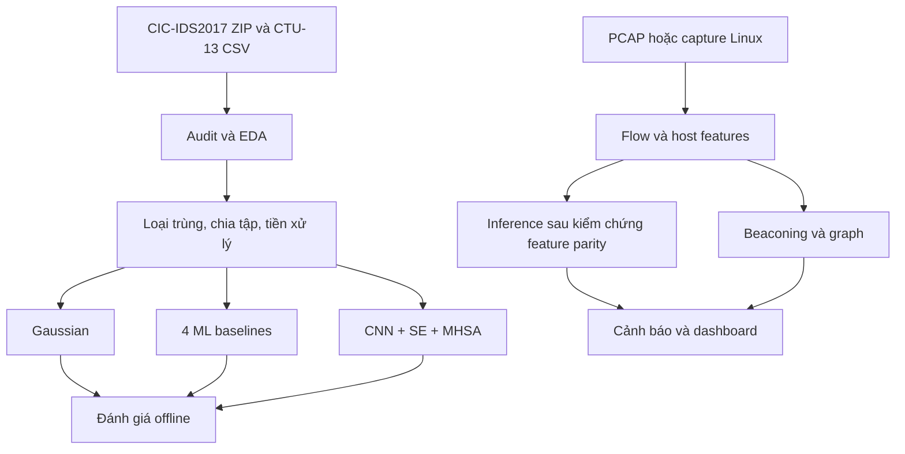

# 1. Thiết lập môi trường và kiến trúc triển khai

> Trạng thái: đã xác nhận môi trường Windows và kiểm thử offline ngày 25/11/2026. Kaggle và Kali là môi trường dự kiến cho các giai đoạn tiếp theo.

## 1.1. Mục tiêu

Xây dựng hệ thống phát hiện xâm nhập mạng (NIDS) dựa trên mô hình CNN mở rộng với Squeeze-and-Excitation (SE) và Multi-Head Self-Attention (MHSA). Hệ thống cần phân loại tấn công, phát hiện bất thường, phân tích liên kết botnet và triển khai giám sát trên Linux theo đề bài môn An toàn thông tin.

## 1.2. Công nghệ và lý do lựa chọn

| Thành phần | Phiên bản ghi nhận | Vai trò |
|---|---|---|
| Windows x64, VS Code | VS Code 1.147.0 | Phát triển và kiểm thử local |
| Python | 3.11 | Xử lý dữ liệu, học máy |
| Git / Git LFS | 2.56.1 / 3.8.1 | Quản lý phiên bản và artifact |
| NumPy / Pandas | 2.4.6 / 2.3.3 | Tính toán và xử lý bảng |
| PyArrow | 26.0.1 | Đọc ghi Parquet |
| scikit-learn | 1.6.1 | Tiền xử lý, baseline, metrics |
| XGBoost / LightGBM | 3.2.0 / 4.7.0 | Gradient boosting |
| PyTorch | 2.15.0+cpu | CNN và inference local |
| Matplotlib | 3.11.2 | Xuất biểu đồ PNG |
| NetworkX | 3.6.1 | Dự kiến phân tích đồ thị |
| Streamlit | 1.67.0 | Dashboard |
| Pytest | 9.2.0 | Kiểm thử tự động |

Phiên bản lấy từ log cài đặt và kiểm tra môi trường của người thực hiện, không phải yêu cầu phiên bản tối thiểu. CPU/GPU cụ thể và RAM chưa được ghi nhận. CUDA local trả về False; full training CNN dự kiến chạy trên Kaggle GPU. Kali Linux dành cho bắt gói và kiểm thử trong mạng lab được phép.

## 1.3. Kiến trúc tổng thể dự kiến



Nhánh offline đã có kết quả smoke cho Gaussian và bốn baseline. Nhánh CNN mới, PCAP và realtime chưa được nghiệm thu trong gói này. Không coi checkpoint V10 cũ là bằng chứng hoàn thành thực nghiệm mới.

## 1.4. Tái lập các bước đã thực hiện

Chạy PowerShell tại thư mục gốc repository `https://github.com/chienvoxn/NIDS` (nhánh main). Cài đặt môi trường nếu chưa có:

```powershell
py -3.11 -m venv .venv
.\.venv\Scripts\Activate.ps1
python -m pip install -r requirements.txt -c constraints-windows.txt
python -m pip check
$env:PYTHONPATH = "src"
```

Đặt ba tệp nguồn tại `data/raw/CIC-IDS2017/MachineLearningCSV.zip` và `data/raw/CTU-13/CTU13_Normal_Traffic.csv`, `data/raw/CTU-13/CTU13_Attack_Traffic.csv`. Chạy các module đã tạo trên máy local:

```powershell
python -m nids.final_data --dataset both
python -m nids.final_baselines --dataset both --smoke
python -m nids.final_visualization --profile smoke
python -m pytest -q
```

Các lệnh trên tái lập quy trình, không bảo đảm thời gian hoặc số đo hoàn toàn giống nhau giữa các phần cứng và phiên bản thư viện. Không chạy lại nếu chỉ cần xem báo cáo.

## 1.5. Kết quả kiểm thử và quản lý phiên bản

Log ghi nhận `58 passed, 1 warning in 5.20s`. Cảnh báo từ `offline.py` liên quan suy luận định dạng timestamp khi kiểm thử dữ liệu timestamp không hợp lệ. Đây là kết quả unit test, không phải kết quả kiểm thử tấn công realtime. Commit nền từng xác nhận: `953f7f8`; chưa có bằng chứng commit/push của các module final trong gói báo cáo. Dữ liệu thô, môi trường ảo và model sinh ra không nên đưa vào Git.

## 1.6. Minh chứng và giới hạn

Nguồn: log Terminal ngày 25/11/2026, các báo cáo audit JSON và ảnh trong gói. Xem [bảng đối chiếu yêu cầu](00_REQUIREMENTS_TRACEABILITY.md) để phân biệt hạng mục đã có kết quả với hạng mục chưa nghiệm thu.
