# 2. Bộ dữ liệu và phân tích khám phá (EDA)

## 2.1. Mục tiêu và lựa chọn dữ liệu

Hai bộ dữ liệu được sử dụng riêng biệt: CIC-IDS2017 phục vụ phân loại đa lớp; CTU-13 CSV dẫn xuất phục vụ phân loại nhị phân traffic gắn nhãn attack/non-attack. Hai schema khác nhau nên không nối trực tiếp để huấn luyện cùng một mô hình. Đặc trưng là thống kê luồng (flow-level), không phải chuỗi gói tin thô.

Nguồn tham khảo nhận diện dataset: [CIC-IDS2017 – UNB](https://www.unb.ca/cic/datasets/ids-2017.html); [CTU-13 gốc – Stratosphere IPS](https://www.stratosphereips.org/datasets-ctu13); [CTU-13 CSV dẫn xuất được chọn](https://github.com/imfaisalmalik/CTU13-CSV-Dataset). Các liên kết nguồn này không thay thế việc đối chiếu checksum của file thực tế.

| Dataset | Mẫu gốc | Đặc trưng chọn | Số lớp |
| --- | --- | --- | --- |
| CIC-IDS2017 | 2.830.743 | 60 | 15 |
| CTU-13 (CSV dẫn xuất) | 92.212 | 57 | 2 |

CIC gồm tám CSV trong MachineLearningCSV.zip, mỗi CSV có 79 cột khi đọc header. Danh sách 60 đặc trưng được lấy từ manifest V10 hiện có, không khẳng định đây là bộ đặc trưng tối ưu. CTU gồm hai CSV, mỗi file có 59 cột; bỏ chỉ số dòng và nhãn còn 57 đặc trưng. Nhãn 0 của bản dẫn xuất nên hiểu theo quy ước nguồn non-attack, không đồng nhất chắc chắn với traffic benign đã được xác minh độc lập.

## 2.2. Phân bố lớp và tác động mất cân bằng

### CIC-IDS2017

| Lớp | Trước làm sạch | Sau làm sạch | Tỷ lệ gốc |
| --- | --- | --- | --- |
| BENIGN | 2.273.097 | 2.095.786 | 80,30% |
| DoS Hulk | 231.073 | 172.719 | 8,16% |
| PortScan | 158.930 | 90.255 | 5,61% |
| DDoS | 128.027 | 128.013 | 4,52% |
| DoS GoldenEye | 10.293 | 10.286 | 0,36% |
| FTP-Patator | 7.938 | 5.933 | 0,28% |
| SSH-Patator | 5.897 | 3.219 | 0,21% |
| DoS slowloris | 5.796 | 5.384 | 0,20% |
| DoS Slowhttptest | 5.499 | 5.228 | 0,19% |
| Bot | 1.966 | 1.953 | 0,07% |
| Web Attack - Brute Force | 1.507 | 1.470 | 0,05% |
| Web Attack - XSS | 652 | 652 | 0,02% |
| Infiltration | 36 | 36 | 0,00% |
| Web Attack - Sql Injection | 21 | 21 | 0,00% |
| Heartbleed | 11 | 11 | 0,00% |

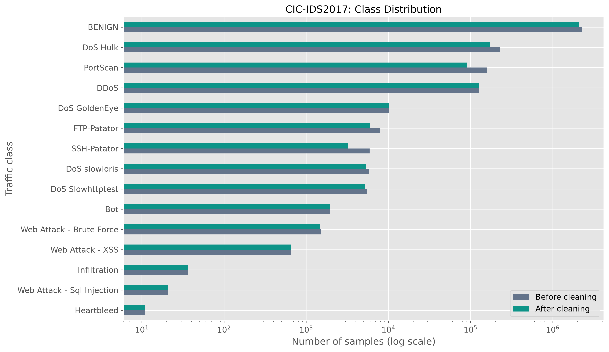

*Hình 2.1. CIC-IDS2017: phân bố lớp trước và sau làm sạch (trục log).*

BENIGN chiếm 80,30% dữ liệu gốc; Heartbleed chỉ có 11 mẫu, SQL Injection 21 và Infiltration 36. Weighted F1 có thể bị chi phối bởi lớp lớn; cần xem support và recall từng lớp. Sau làm sạch, tỷ lệ BENIGN tăng, không được giả định phân bố ban đầu giữ nguyên.

### CTU-13 (CSV dẫn xuất)

| Lớp | Trước làm sạch | Sau làm sạch | Tỷ lệ gốc |
| --- | --- | --- | --- |
| 0 | 53.314 | 51.970 | 57,82% |
| 1 | 38.898 | 30.749 | 42,18% |

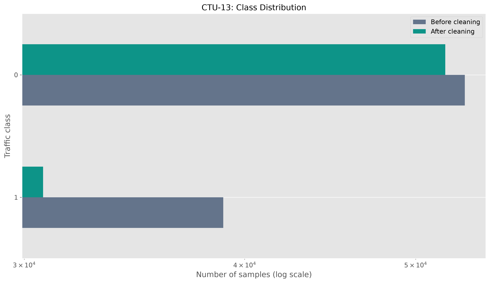

*Hình 2.2. CTU-13 (CSV dẫn xuất): phân bố lớp trước và sau làm sạch (trục log).*

Lớp 0 chiếm khoảng 57,82% ban đầu và 62,83% sau làm sạch. Loại trùng làm thay đổi phân bố; chưa cần SMOTE mặc định nhưng cần kiểm tra recall lớp 1. Trục log ở hình CTU có thể làm chênh lệch trông lớn hơn; dùng bảng số liệu để diễn giải.

## 2.3. Phân tích tương quan và phân bố đặc trưng

Ma trận Pearson được tính trên mẫu ngẫu nhiên tối đa 30.000 dòng của tập train (seed 42), trước imputation và scaling. Hệ số tương quan nằm trong [-1, 1]; các cụm màu đỏ/xanh phản ánh quan hệ tuyến tính cùng/ngược chiều. Ô thiếu màu có thể do phương sai bằng 0 hoặc thiếu dữ liệu. Tương quan cao không tự chứng minh quan hệ nhân quả hay đủ cơ sở bỏ đặc trưng.

Các histogram dùng phép biến đổi chỉ để trực quan hóa:

$$x'=\operatorname{sign}(x)\ln(1+|x|).$$

Trục tung biểu diễn mật độ, không phải số mẫu; các histogram gốc dùng 50 bins riêng theo nhóm nên chỉ nên nhận xét định tính, không so trực tiếp độ cao từng bin như xác suất cùng khoảng. Phép log này không phải phép scaling trong pipeline huấn luyện.

### CIC-IDS2017

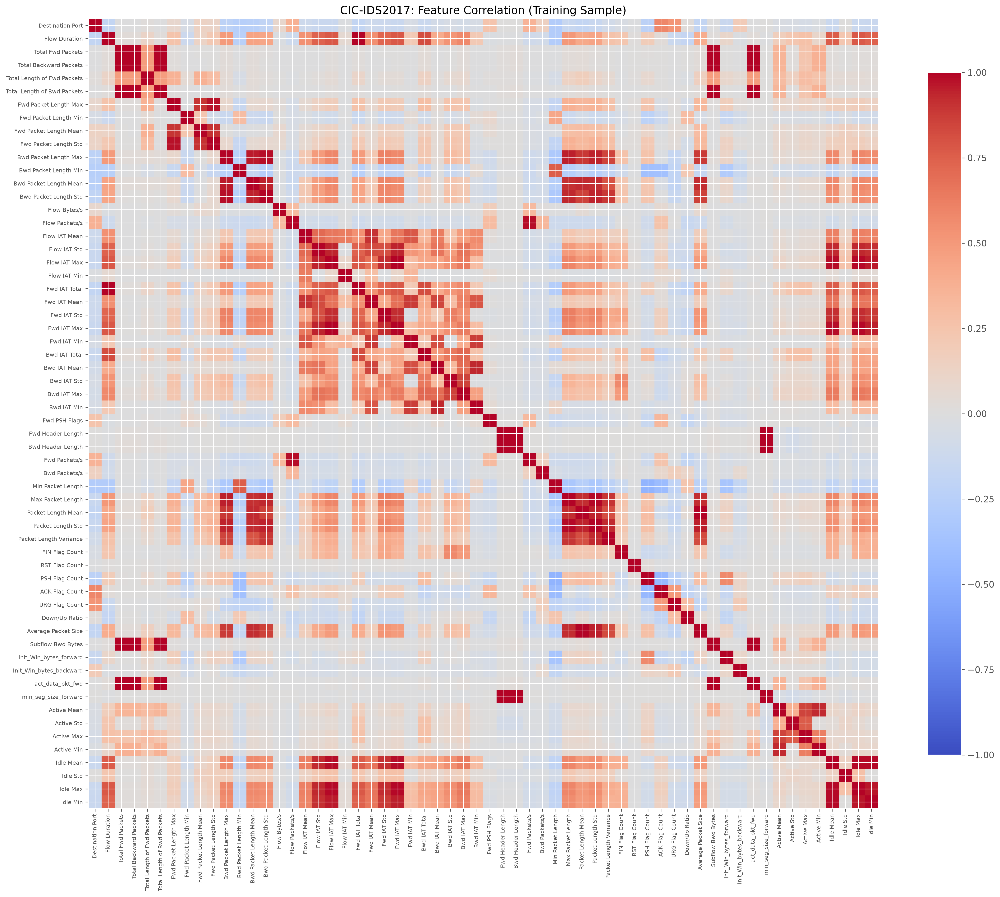

*Hình 2.3. CIC-IDS2017: tương quan đặc trưng trên mẫu train.*

Hình cho thấy các cụm tương quan giữa các thống kê kích thước gói và khoảng cách thời gian IAT; cần số liệu hệ số cụ thể trước khi chọn bỏ đặc trưng.

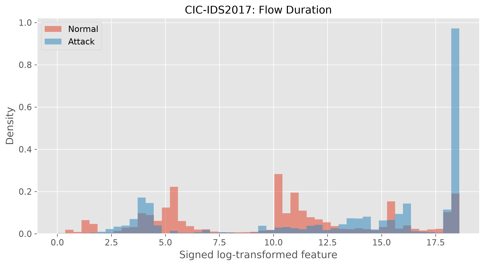

*Hình 2.4. CIC-IDS2017: phân bố Flow Duration.*

Phân bố thời lượng có các vùng tập trung khác nhau, nhưng vẫn chồng lấn giữa hai nhóm.

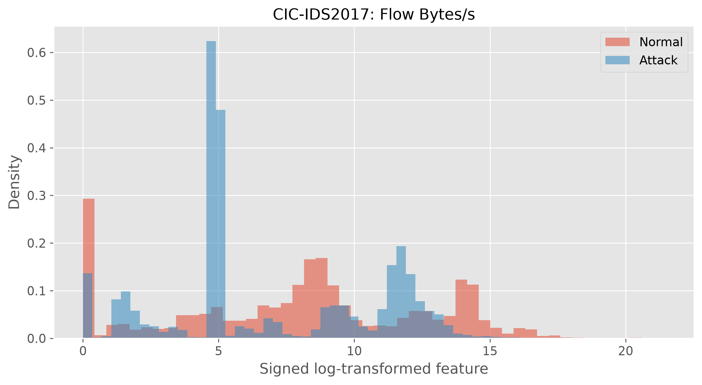

*Hình 2.5. CIC-IDS2017: phân bố Flow Bytes/s (Byts/s).*

Lưu lượng byte mỗi giây có các đỉnh khác nhau; giá trị thấp không mặc nhiên là benign.

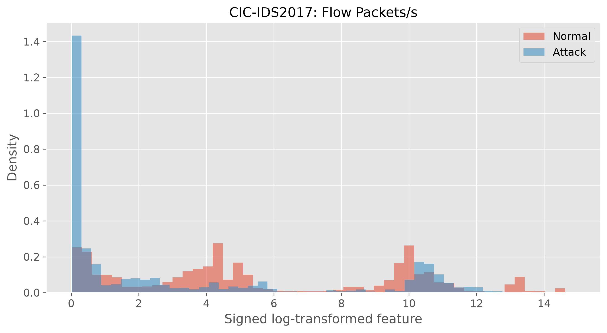

*Hình 2.6. CIC-IDS2017: phân bố Flow Packets/s (Pkts/s).*

Mật độ tốc độ gói tin có vùng tập trung thấp ở nhóm attack và vùng chồng lấn với normal.

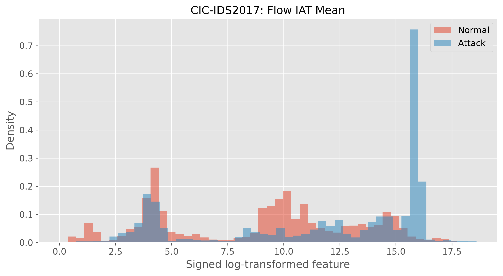

*Hình 2.7. CIC-IDS2017: phân bố Flow IAT Mean.*

Khoảng cách trung bình giữa gói tin có các đỉnh khác nhau; đây là IAT trong flow, không phải chu kỳ beaconing giữa các flow.

### CTU-13 (CSV dẫn xuất)

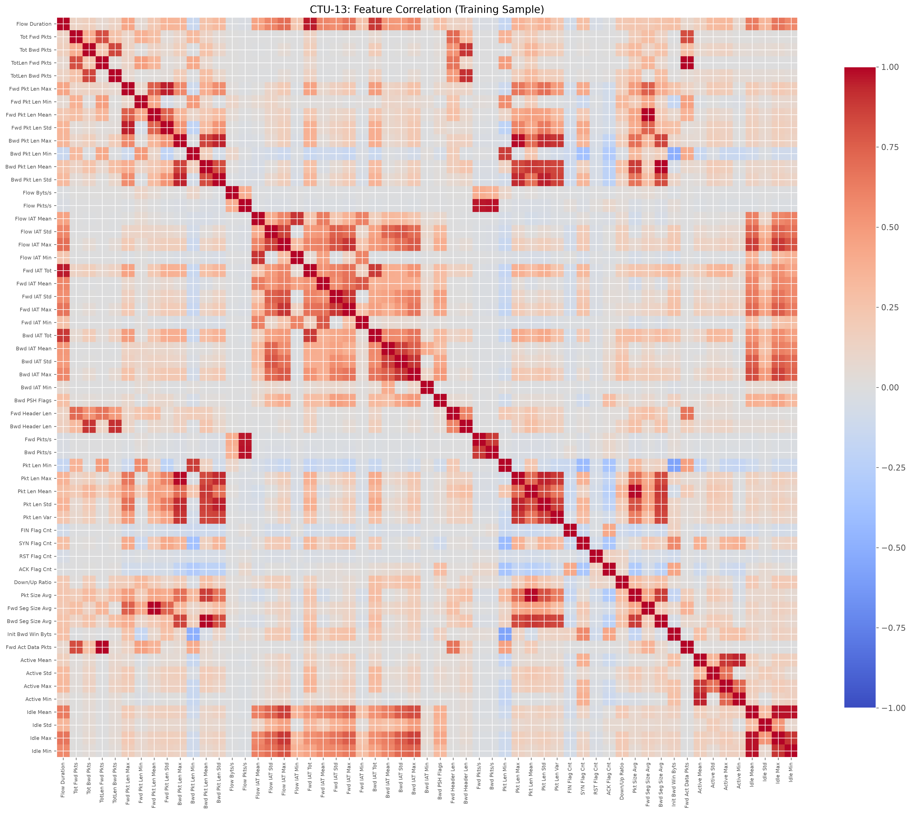

*Hình 2.8. CTU-13 (CSV dẫn xuất): tương quan đặc trưng trên mẫu train.*

Hình cho thấy các cụm tương quan giữa các thống kê kích thước gói và khoảng cách thời gian IAT; cần số liệu hệ số cụ thể trước khi chọn bỏ đặc trưng.

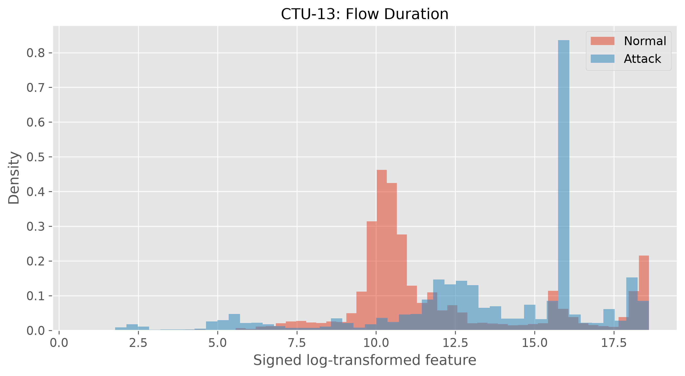

*Hình 2.9. CTU-13 (CSV dẫn xuất): phân bố Flow Duration.*

Phân bố thời lượng có các vùng tập trung khác nhau, nhưng vẫn chồng lấn giữa hai nhóm.

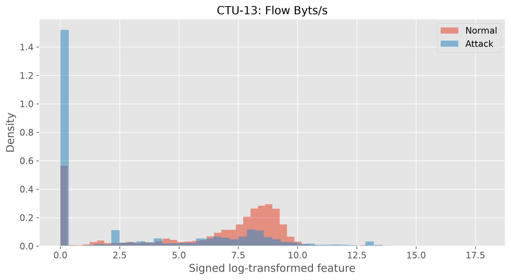

*Hình 2.10. CTU-13 (CSV dẫn xuất): phân bố Flow Bytes/s (Byts/s).*

Lưu lượng byte mỗi giây có các đỉnh khác nhau; giá trị thấp không mặc nhiên là benign.

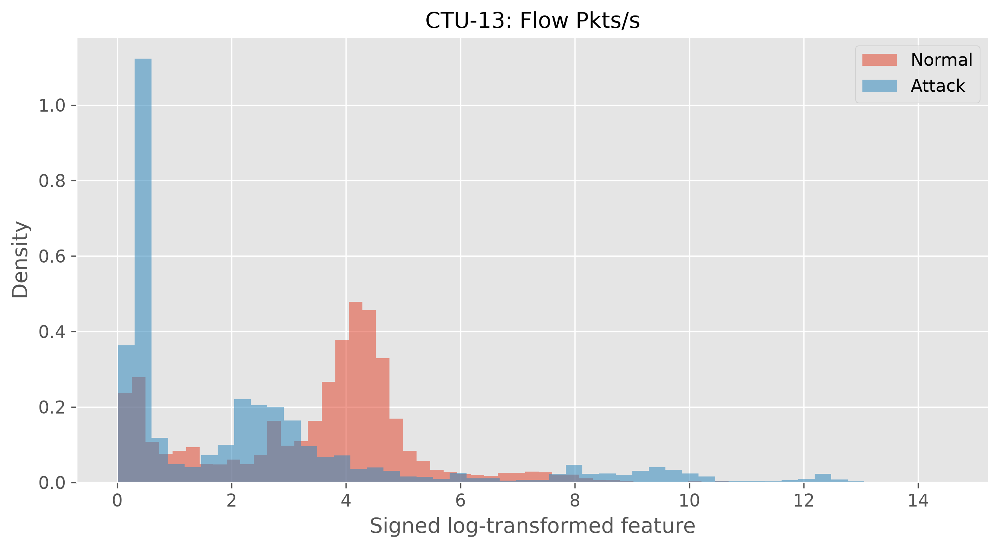

*Hình 2.11. CTU-13 (CSV dẫn xuất): phân bố Flow Packets/s (Pkts/s).*

Mật độ tốc độ gói tin có vùng tập trung thấp ở nhóm attack và vùng chồng lấn với normal.

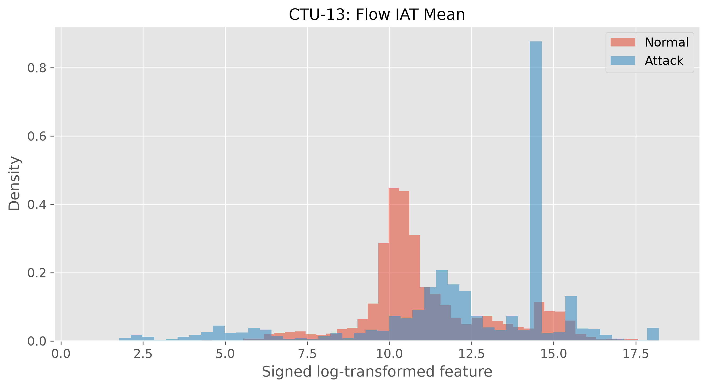

*Hình 2.12. CTU-13 (CSV dẫn xuất): phân bố Flow IAT Mean.*

Khoảng cách trung bình giữa gói tin có các đỉnh khác nhau; đây là IAT trong flow, không phải chu kỳ beaconing giữa các flow.

## 2.4. Kết luận EDA và giới hạn

Cả hai bộ dữ liệu phù hợp cho phân loại dựa trên đặc trưng flow. EDA cho thấy cần xử lý lớp hiếm, đặc trưng có phân bố lệch và các nhóm đặc trưng tương quan. Không thể suy ra hiệu quả phát hiện từng kiểu tấn công chỉ từ các histogram nhị phân. Hai CSV CTU và bộ CIC đang dùng không chứa đầy đủ IP nguồn/đích và timestamp; cần flow metadata hoặc PCAP thực tế bổ sung cho host-level, graph và beaconing. Chưa có bảng thống kê mô tả đầy đủ (median, quartile, độ lệch chuẩn theo feature); bổ sung khi chạy thực nghiệm chính thức. Minh chứng số liệu: [CIC audit](cic_data_audit.json), [CTU audit](ctu_data_audit.json).
