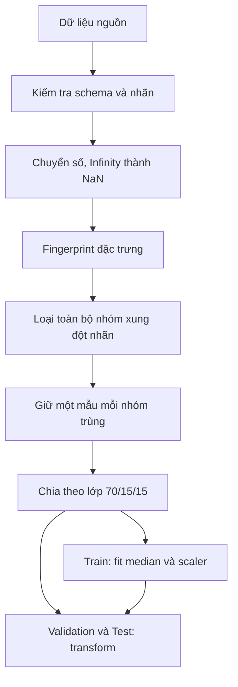
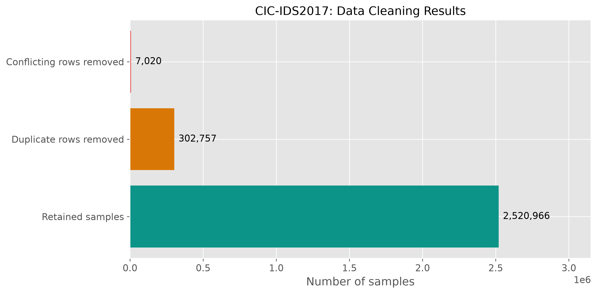
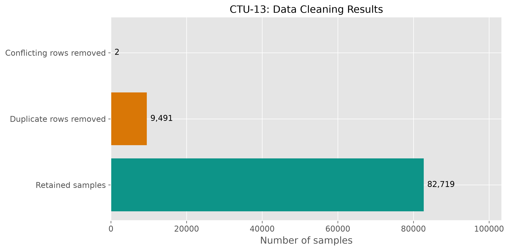
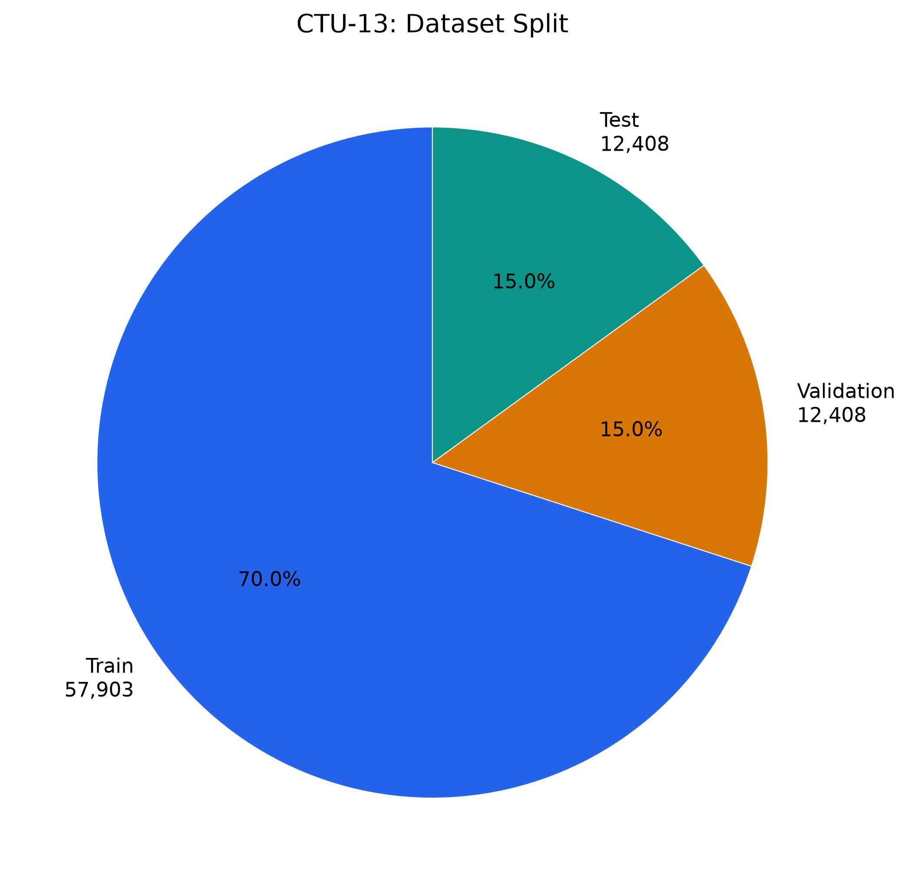

# 3. Tiền xử lý dữ liệu và phòng tránh rò rỉ dữ liệu

## 3.1. Quy trình

Module `src/nids/final_data.py` đọc CSV trực tiếp từ ZIP theo chunk 100.000 dòng, kiểm tra schema, chuẩn hóa nhãn CIC, kiểm tra nhãn CTU và loại `Unnamed: 0`. Đặc trưng được chuyển sang float64 để kiểm tra dữ liệu; Infinity được chuyển thành NaN. Không điền median trước chia tập.

Fingerprint 64-bit của vector đặc trưng (không gồm nhãn) được dùng để phát hiện trùng. Nhóm có nhiều nhãn bị loại hoàn toàn vì không thể xác minh nhãn đúng từ file hiện có. Nhóm còn lại giữ dòng đầu tiên. Cách này tránh đưa cùng fingerprint vào nhiều tập, nhưng chưa chứng minh không có va chạm hash hoặc near-duplicate. Loại các flow giống hệt có thể làm mất thông tin tần suất; kết quả chỉ áp dụng cho tập sau làm sạch.

## 3.2. Kết quả làm sạch

| Chỉ tiêu | CIC-IDS2017 | CTU-13 |
| --- | --- | --- |
| Mẫu ban đầu | 2.830.743 | 92.212 |
| Ô thiếu | 1.358 | 0 |
| Ô Infinity | 4.376 | 0 |
| Nhóm xung đột | 698 | 1 |
| Mẫu xung đột bị loại | 7.020 | 2 |
| Mẫu trùng bị loại sau xử lý xung đột | 302.757 | 9.491 |
| Mẫu còn lại | 2.520.966 | 82.719 |

Số ô thiếu và Infinity không phải số dòng bị loại. Hai nhóm loại trừ (xung đột và trùng) được thống kê tuần tự, không cộng trùng. CIC giữ khoảng 89,06% dữ liệu, CTU giữ khoảng 89,71%. Cả hai vẫn giữ đủ lớp theo manifest.

*Hình 3.1. CIC-IDS2017: kết quả làm sạch.*

*Hình 3.2. CTU-13 (CSV dẫn xuất): kết quả làm sạch.*

## 3.3. Phân chia tập và chuẩn hóa

Chia ngẫu nhiên phân tầng theo nhãn sau loại trùng, seed 42. Tỷ lệ mục tiêu 70/15/15; số lượng thực tế làm tròn theo lớp, mỗi lớp phải đủ mẫu cho ba tập.

| Tập | CIC-IDS2017 | CTU-13 |
| --- | --- | --- |
| Train | 1.764.676 | 57.903 |
| Validation | 378.145 | 12.408 |
| Test | 378.145 | 12.408 |

*Hình 3.3. CIC-IDS2017: phân chia dữ liệu.*

*Hình 3.4. CTU-13 (CSV dẫn xuất): phân chia dữ liệu.*

Median imputation và StandardScaler được fit chỉ trên train trong `final_baselines.py`; validation và test chỉ transform bằng tham số đã fit:

$$x_{ij}^{*}=\begin{cases}x_{ij}&\text{nếu hữu hạn}\\\operatorname{median}(X_{train,j})&\text{nếu thiếu}\end{cases}$$

$$z_{ij}=\frac{x_{ij}^{*}-\mu_{train,j}}{\sigma_{train,j}}.$$

StandardScaler xử lý đặc trưng có phương sai bằng 0 bằng hệ số scale 1. LabelEncoder được fit trên train. Việc sử dụng cùng bộ biến đổi giúp tái lập phép đo, đặc biệt với KNN nhạy cảm với thang đo. Chưa có bước chọn thêm feature dựa trên tập test.

## 3.4. Mất cân bằng và giao thức smoke

RF sử dụng balanced_subsample, XGBoost sử dụng sample weight cân bằng, LightGBM dùng class_weight balanced cho CIC; CTU không dùng trọng số mặc định, KNN không có trọng số theo lớp (distance weighting là trọng số theo khoảng cách). Chưa sử dụng SMOTE/ADASYN trong kết quả này. Nếu thử oversampling, chỉ áp dụng trên train, không thay đổi validation/test.

Smoke lấy mẫu phân tầng từ từng tập đã chia, tối thiểu một mẫu mỗi lớp, mục tiêu 15.000/5.000/5.000; do làm tròn theo lớp, CIC thực tế 15.003/5.003/5.003. Các kết quả này chỉ kiểm tra pipeline. Tập smoke test là một phần của full test; đã quan sát nó nên không được tuyên bố toàn bộ full test chưa từng được xem. Cần chốt giao thức và cấu hình bằng validation trước đánh giá chính thức, hoặc thiết kế holdout độc lập nếu muốn khẳng định khả năng tổng quát.

## 3.5. Khả năng tái lập và hạn chế

Hai audit JSON chứa SHA256 nguồn và chỉ số chia tập, danh sách đặc trưng, phân bố từng tập. File Parquet và split_indices.npz nằm trong `data/processed/final/{cic,ctu}/` trên máy phát triển, không kèm gói báo cáo. Chưa xác minh độc lập fingerprint bằng dữ liệu đã xuất. Split nội bộ không phải cross-day, cross-host hay cross-scenario. Heartbleed chỉ có 7/2/2 mẫu trên train/validation/test đầy đủ; kết luận từng lớp rất bất ổn. Không được suy ra khả năng phát hiện tấn công mới từ split này.

Minh chứng: [CIC audit](cic_data_audit.json), [CTU audit](ctu_data_audit.json).
