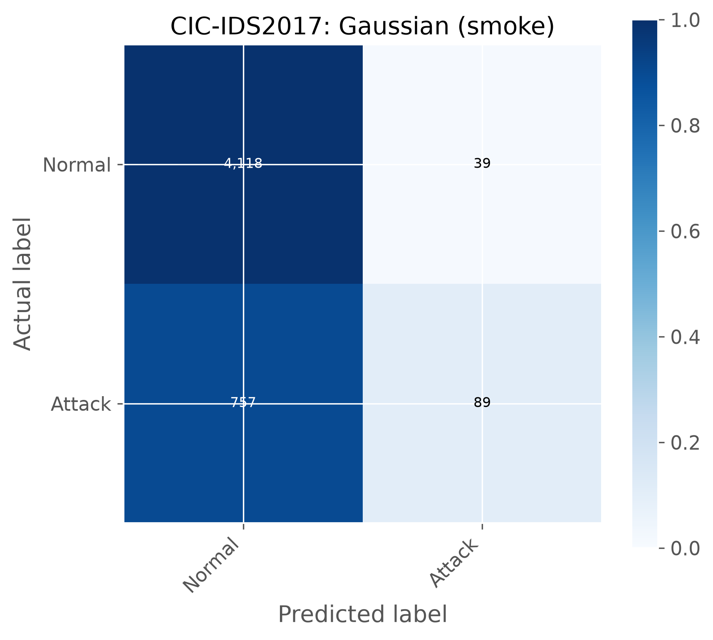
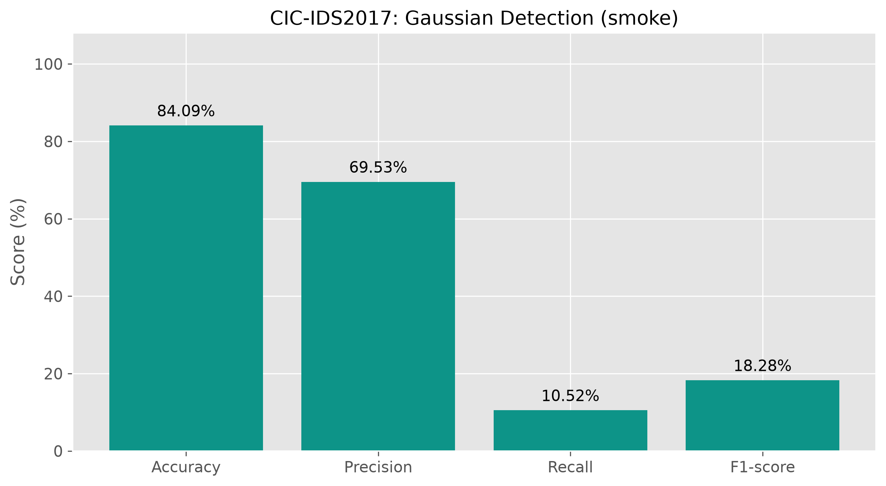
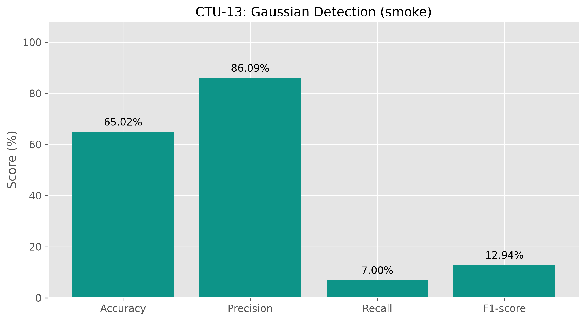

# 4. Phát hiện bất thường bằng Gaussian

> Kết quả smoke offline, không phải nghiệm thu triển khai realtime.

## 4.1. Cơ sở lý thuyết và phương pháp

Gaussian mô hình hóa phân bố đặc trưng bình thường. Với giả định các chiều độc lập có điều kiện, mật độ của một chiều là:

$$p(x_j)=\frac{1}{\sqrt{2\pi\sigma_j^2}}\exp\left(-\frac{(x_j-\mu_j)^2}{2\sigma_j^2}\right).$$

Trong code thực tế, sau preprocessing chung fit trên train, chỉ các mẫu normal của train được dùng để ước lượng trung bình và phương sai. Hàm điểm bất thường là tổng bình phương sai lệch chuẩn hóa, tương đương phần biến thiên của negative log-likelihood đường chéo:

$$S(x)=\sum_{j=1}^{d}\frac{(x_j-\mu_j)^2}{\max(\sigma_j^2,10^{-6})}.$$

Ngưỡng $\tau=Q_{0.99}(S(X_{val,normal}))$ được lấy từ phân vị 99% của điểm normal validation. Dự đoán attack khi $S(x)>\tau$. Không dùng test để chọn ngưỡng. CIC quy đổi BENIGN thành 0 và các lớp khác thành 1; CTU dùng nhãn nguồn 0/1. Đây là phương pháp one-class có sử dụng nhãn normal để fit, không phải học không giám sát hoàn toàn trên dữ liệu hỗn hợp.

## 4.2. Chỉ số đánh giá

$$Accuracy=\frac{TP+TN}{TP+TN+FP+FN},\quad Precision=\frac{TP}{TP+FP}$$

$$Recall=\frac{TP}{TP+FN},\quad F1=\frac{2PR}{P+R},\quad FPR=\frac{FP}{FP+TN}.$$

Recall của lớp attack cũng là detection rate. Giá trị bằng 0 được quy ước khi mẫu số bằng 0 trong các metric scikit-learn.

## 4.3. Kết quả thực nghiệm

| Metric | CIC (%) | CTU (%) |
| --- | --- | --- |
| Accuracy | 84,0895 | 65,0200 |
| Precision | 69,5312 | 86,0927 |
| Recall | 10,5201 | 6,9968 |
| F1-score | 18,2752 | 12,9418 |
| FPR | 0,9382 | 0,6684 |

| Dataset | TN | FP | FN | TP | Test |
| --- | --- | --- | --- | --- | --- |
| CIC | 4118 | 39 | 757 | 89 | 5003 |
| CTU | 3121 | 21 | 1728 | 130 | 5000 |

*Hình 4.1. CIC-IDS2017: ma trận nhầm lẫn (số mẫu; màu chuẩn hóa theo hàng), smoke.*

*Hình 4.2. CIC-IDS2017: các chỉ số phát hiện bất thường, smoke.*

*Hình 4.3. CTU-13 (CSV dẫn xuất): ma trận nhầm lẫn (số mẫu; màu chuẩn hóa theo hàng), smoke.*

*Hình 4.4. CTU-13 (CSV dẫn xuất): các chỉ số phát hiện bất thường, smoke.*

## 4.4. Nhận xét và hướng cải thiện

CIC phát hiện đúng 89/846 mẫu attack, bỏ sót 757. CTU phát hiện đúng 130/1.858, bỏ sót 1.728. FPR dưới 1% nhưng tỷ lệ bỏ sót lần lượt khoảng 89,48% và 93,00%. Accuracy cao trên CIC một phần do tỷ lệ normal lớn, không thể dùng làm căn cứ duy nhất để đánh giá an toàn hệ thống. Giả định Gaussian đường chéo bỏ qua tương quan và phân bố đa đỉnh; ngưỡng cao cũng có thể làm giảm recall.

Ưu điểm: huấn luyện đơn giản, điểm số dễ tính, có thể phát hiện bất thường mà không cần học từng lớp attack. Nhược điểm: nhạy với phân phối, outlier và ngưỡng, hiệu quả phát hiện thấp trong thí nghiệm hiện tại.

Đề xuất khảo sát các phân vị 90/95/97/99 trên validation, báo cáo trade-off recall–FPR và chọn ngưỡng theo mục tiêu được định trước (ví dụ tối đa recall trong ngân sách FPR). Chưa thực hiện khảo sát này. Gaussian không nên là bộ lọc bắt buộc loại bỏ mọi flow có score thấp trước CNN; nên thử dùng tín hiệu bổ sung hoặc chạy song song để giảm bỏ sót. So sánh Gaussian với classifier phải dùng cùng bài toán nhị phân và cùng test; không so trực tiếp binary F1 Gaussian với weighted F1 CIC đa lớp.

Mã nguồn: `src/nids/final_baselines.py::run_gaussian`, `src/nids/final_metrics.py`. Minh chứng: [log thực nghiệm](evidence/terminal_smoke_excerpt.txt).
