# 5. Các mô hình học máy cơ sở (ML Baselines)

> Kết quả smoke trên cùng tập con đã chia trong từng dataset; chưa phải kết quả full training hoặc bằng chứng mô hình CNN vượt baseline.

## 5.1. Lựa chọn thuật toán

| Mô hình | Nguyên lý | Ưu điểm | Hạn chế |
|---|---|---|---|
| Random Forest | Bagging nhiều cây, bỏ phiếu | Mạnh với dữ liệu bảng, quan hệ phi tuyến | Tốn bộ nhớ, nhiều cây làm tăng chi phí inference |
| XGBoost | Boosting cây theo gradient, regularization | Hiệu quả dữ liệu bảng, điều chỉnh trọng số mẫu | Nhạy với siêu tham số và mất cân bằng |
| LightGBM | Boosting histogram, phát triển cây theo lá | Huấn luyện nhanh, hiệu quả với dữ liệu lớn | Có thể overfit lớp ít mẫu nếu cây quá phức tạp |
| KNN | Bỏ phiếu từ k láng giềng theo khoảng cách | Đơn giản, không cần tối ưu tham số phức tạp | Nhạy với scaling, chi phí dự đoán lớn |

Không dùng Decision Tree làm baseline độc lập theo phạm vi đã chốt; các thuật toán ensemble vẫn sử dụng cây làm thành phần bên trong.

## 5.2. Cấu hình thực nghiệm

| Mô hình | Tham số smoke thực tế | Cấu hình full dự kiến, chưa đánh giá |
|---|---|---|
| RF | 30 cây, max_depth=20, min_samples_leaf=2 | 150 cây |
| XGBoost | 30 cây, max_depth=6, learning_rate=0.07, subsample=0.85, colsample_bytree=0.85, hist | 200 cây |
| LightGBM | 30 cây, num_leaves=31, learning_rate=0.07 | 200 cây |
| KNN | k=5, weights=distance, brute | Giới hạn prototype train khoảng 20.000 nếu cần; ghi rõ khi so sánh |

Seed 42; CIC có class weights cho ba mô hình cây, CTU không dùng class weights mặc định. KNN sử dụng dữ liệu đã chuẩn hóa. Smoke train dưới giới hạn KNN nên cả bốn mô hình dùng cùng số mẫu trong từng dataset. Không có tuning validation chính thức ở đợt này.

## 5.3. Giao thức và metric

CIC: 15.003 train, 5.003 validation, 5.003 test. CTU: 15.000 train, 5.000 validation, 5.000 test. Accuracy là tỷ lệ dự đoán đúng. Precision, Recall và F1 được tính theo lớp trước khi tổng hợp. CIC sử dụng weighted theo support lớp:

$$F1_i=\frac{2P_iR_i}{P_i+R_i},\qquad F1_{weighted}=\sum_i\frac{n_i}{N}F1_i.$$

CTU sử dụng binary F1 với lớp dương 1. Weighted Recall trong phân loại đa lớp đơn nhãn bằng Accuracy. FPR tính sau quy đổi normal/attack, không phải trung bình FPR đa lớp. Các giá trị weighted và binary không dùng để xếp hạng chung giữa hai dataset.

## 5.4. Kết quả thực tế

### CIC-IDS2017

| Model | Accuracy (%) | Precision (%) | Recall (%) | F1-score (%) |
| --- | --- | --- | --- | --- |
| Random Forest | 99.4803 | 99.4014 | 99.4803 | 99.4003 |
| XGBoost | 97.9212 | 99.0543 | 97.9212 | 98.4336 |
| LightGBM | 99.2604 | 99.3460 | 99.2604 | 99.2840 |
| KNN | 98.6208 | 98.5410 | 98.6208 | 98.5460 |

| Mô hình | FPR test (%) | F1 validation (%) | Fit (s) |
| --- | --- | --- | --- |
| Random Forest | 0,0962 | 99,4493 | 0,2580 |
| XGBoost | 2,1891 | 98,6096 | 0,8528 |
| LightGBM | 0,5292 | 99,2993 | 0,9200 |
| KNN | 0,7698 | 98,7674 | 0,0028 |

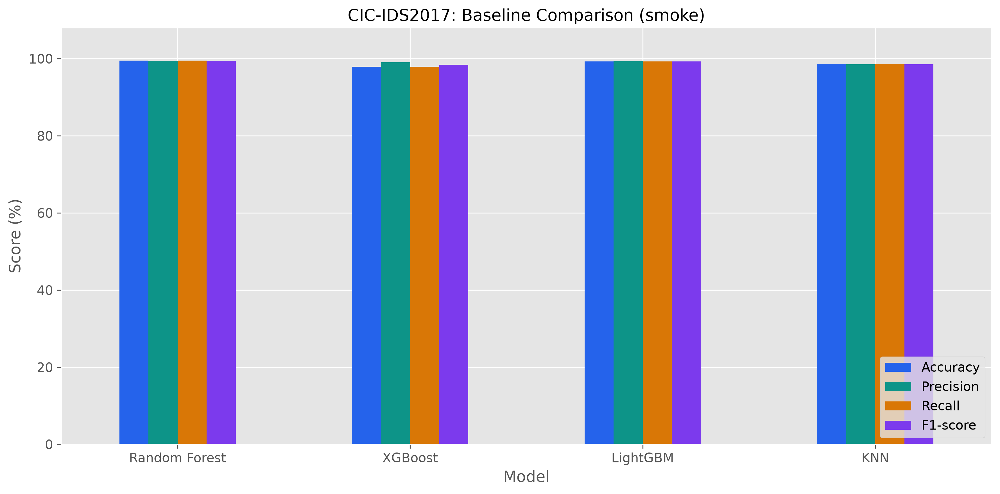

*Hình 5.1. CIC-IDS2017: so sánh Accuracy, Precision, Recall và F1 (smoke).*

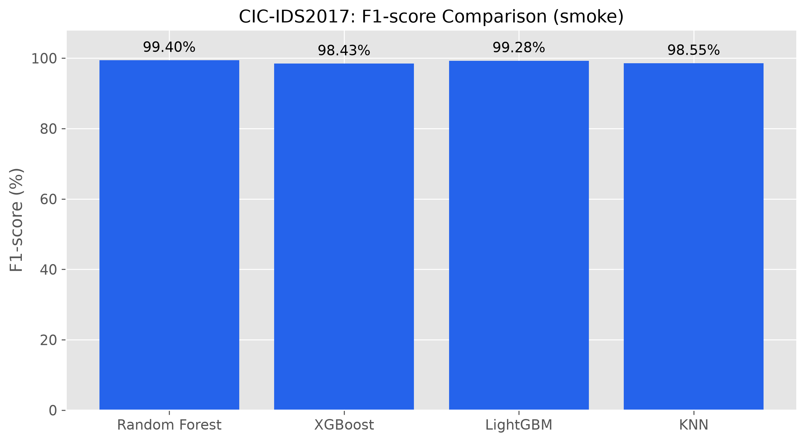

*Hình 5.2. CIC-IDS2017: so sánh F1-score (smoke).*

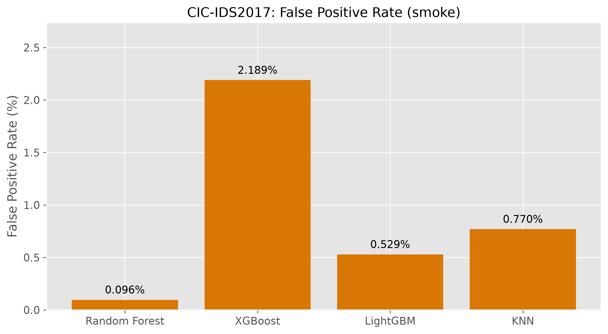

*Hình 5.3. CIC-IDS2017: tỷ lệ báo động giả (smoke).*

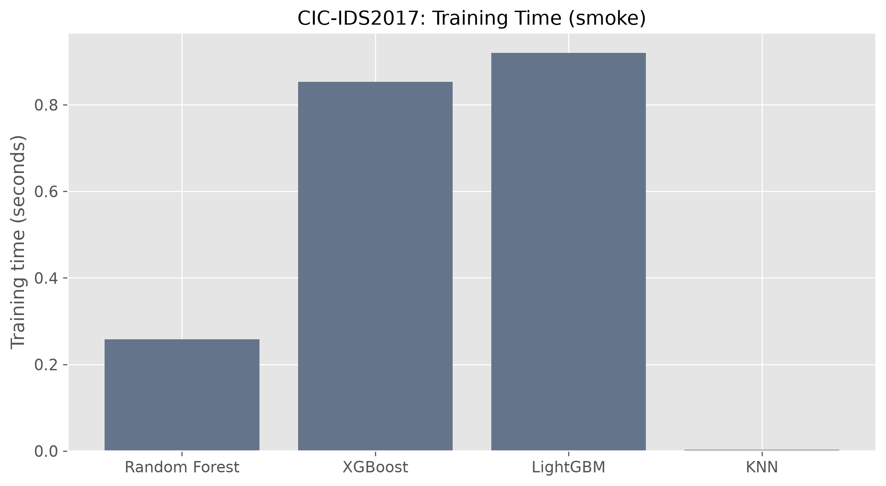

*Hình 5.4. CIC-IDS2017: thời gian fit (smoke).*

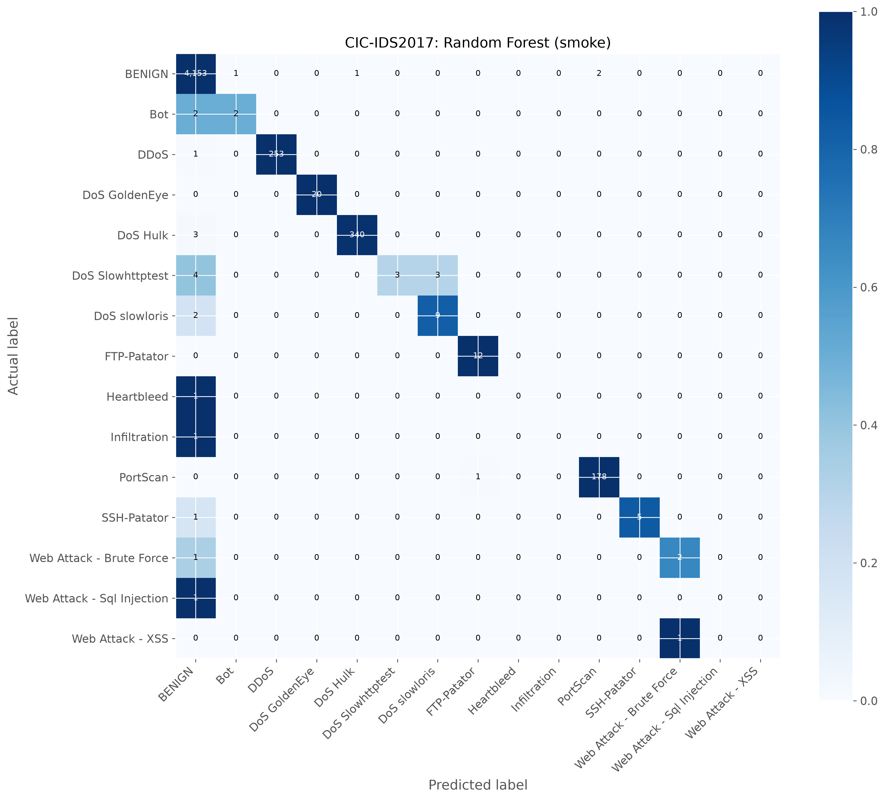

*Hình 5.5. CIC-IDS2017: ma trận nhầm lẫn Random Forest (smoke).*

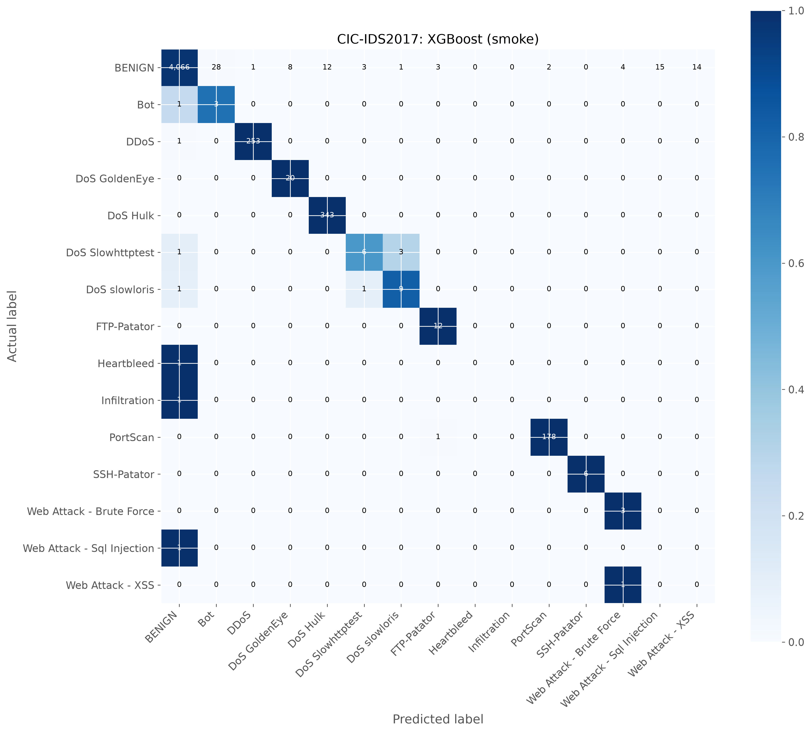

*Hình 5.6. CIC-IDS2017: ma trận nhầm lẫn XGBoost (smoke).*

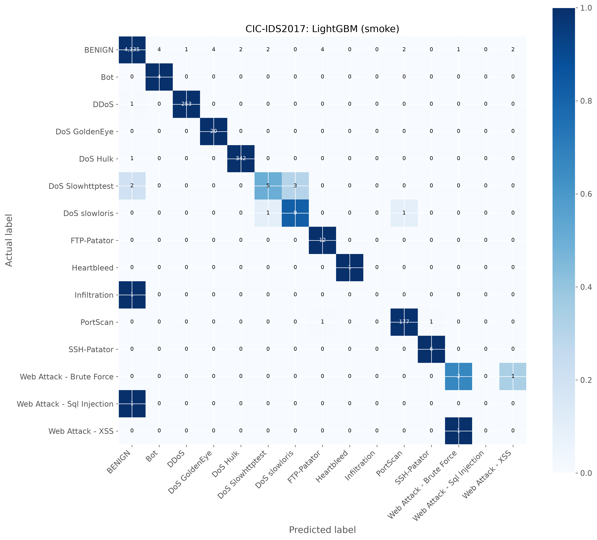

*Hình 5.7. CIC-IDS2017: ma trận nhầm lẫn LightGBM (smoke).*

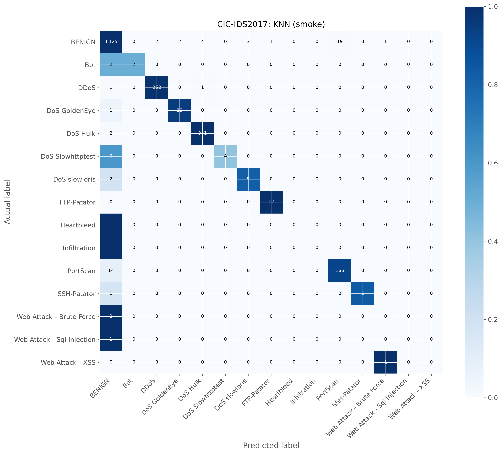

*Hình 5.8. CIC-IDS2017: ma trận nhầm lẫn KNN (smoke).*

RF có weighted F1 test cao nhất (99,4003%) và FPR thấp nhất (0,0962%). XGBoost có FPR cao nhất trong bốn mô hình (2,1891%). Các ma trận có ô ngoài đường chéo, đặc biệt ở một số lớp hiếm; không thể diễn giải điểm weighted cao là mọi lớp được phát hiện tốt.

### CTU-13 (CSV dẫn xuất)

| Model | Accuracy (%) | Precision (%) | Recall (%) | F1-score (%) |
| --- | --- | --- | --- | --- |
| Random Forest | 99.3800 | 98.9288 | 99.4080 | 99.1678 |
| XGBoost | 99.2400 | 99.4565 | 98.4930 | 98.9724 |
| LightGBM | 99.4400 | 99.5130 | 98.9774 | 99.2445 |
| KNN | 98.8800 | 98.6501 | 98.3315 | 98.4906 |

| Mô hình | FPR test (%) | F1 validation (%) | Fit (s) |
| --- | --- | --- | --- |
| Random Forest | 0,6365 | 99,1948 | 0,1401 |
| XGBoost | 0,3183 | 98,9183 | 0,4996 |
| LightGBM | 0,2864 | 99,0003 | 0,1184 |
| KNN | 0,7957 | 98,3571 | 0,0023 |

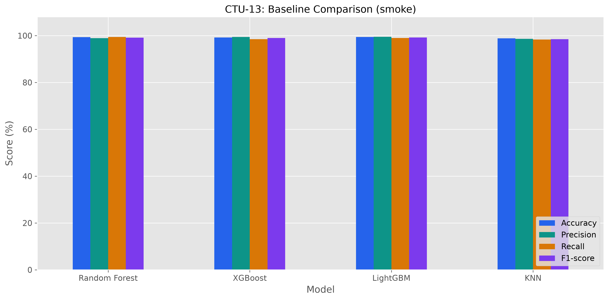

*Hình 5.9. CTU-13 (CSV dẫn xuất): so sánh Accuracy, Precision, Recall và F1 (smoke).*

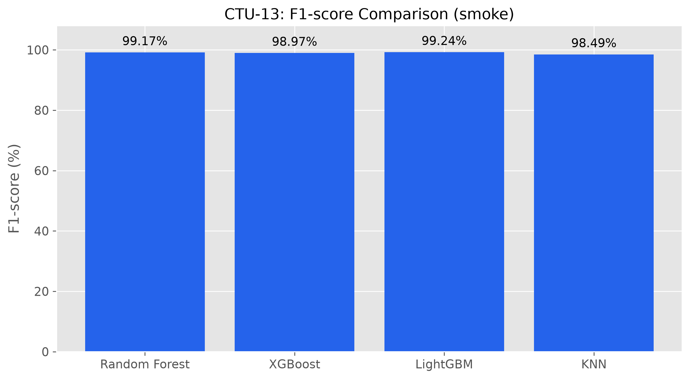

*Hình 5.10. CTU-13 (CSV dẫn xuất): so sánh F1-score (smoke).*

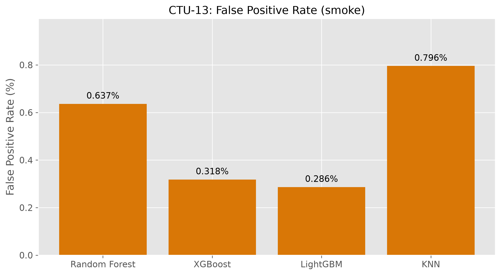

*Hình 5.11. CTU-13 (CSV dẫn xuất): tỷ lệ báo động giả (smoke).*

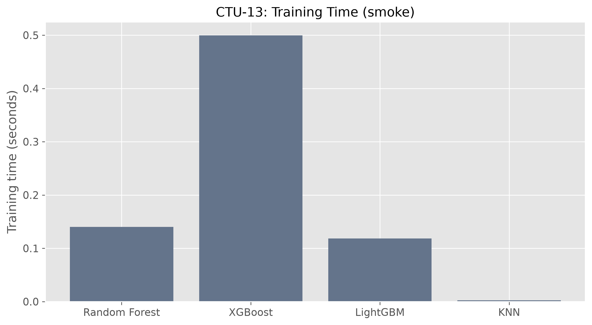

*Hình 5.12. CTU-13 (CSV dẫn xuất): thời gian fit (smoke).*

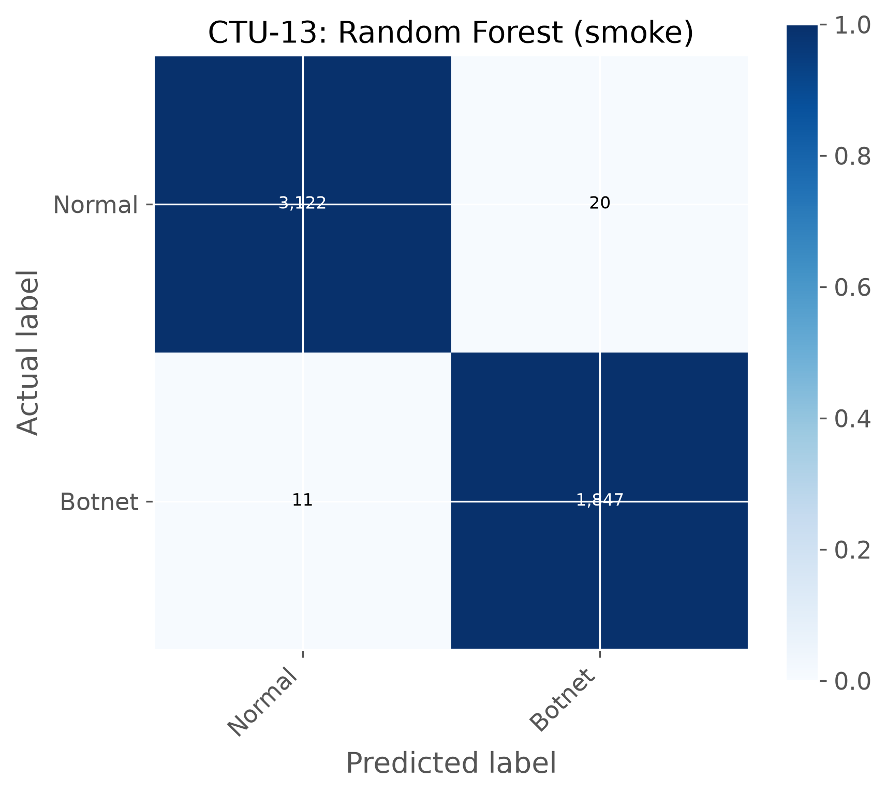

*Hình 5.13. CTU-13 (CSV dẫn xuất): ma trận nhầm lẫn Random Forest (smoke).*

*Hình 5.14. CTU-13 (CSV dẫn xuất): ma trận nhầm lẫn XGBoost (smoke).*

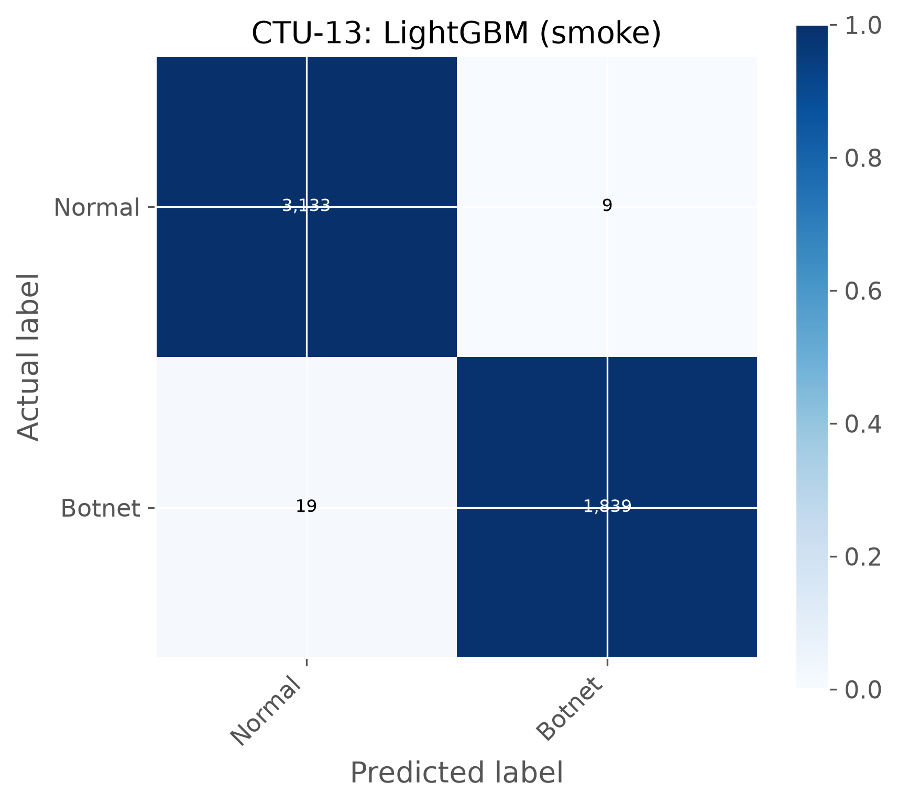

*Hình 5.15. CTU-13 (CSV dẫn xuất): ma trận nhầm lẫn LightGBM (smoke).*

*Hình 5.16. CTU-13 (CSV dẫn xuất): ma trận nhầm lẫn KNN (smoke).*

LightGBM có binary F1 test cao nhất (99,2445%) và FPR thấp nhất (0,2864%); RF có recall cao hơn (99,4080%) và F1 validation cao nhất. Vì lựa chọn mô hình phải dựa trên validation, không chọn LightGBM chỉ vì test cao nhất. Với 3.142 normal và 1.858 attack, RF bỏ sót 11 attack và báo động giả 20; LightGBM bỏ sót 19 attack và báo động giả 9. Đây là trade-off giữa bỏ sót và báo động giả.

## 5.5. Phân tích và giới hạn

Các confusion matrix ghi số mẫu trong ô và màu chuẩn hóa theo hàng (tỷ lệ trong lớp thực). Các biểu đồ thời gian chỉ đo fit trên CPU, không bao gồm preprocessing hoặc inference; KNN fit rất nhanh do chủ yếu lưu mẫu, không chứng minh dự đoán nhanh. Log cung cấp thời gian fit nhưng chưa kèm số đo inference trong gói ZIP; cần trích từ baseline_metrics.json trên máy phát triển. Bảng per-class precision/recall/F1/support cũng cần lấy từ JSON này, không tự suy ra số liệu chưa đọc được. Kết quả full cần dùng cùng split và preprocessing cho CNN/baseline, lựa chọn cấu hình bằng validation, ghi rõ nếu KNN chỉ dùng prototype train. Phải báo cáo kết quả thực tế kể cả khi CNN không vượt baseline.

Nguồn: [log smoke](evidence/terminal_smoke_excerpt.txt); code `src/nids/final_baselines.py`, `src/nids/final_metrics.py`, `src/nids/final_visualization.py`. Các ảnh gốc được giữ nguyên.
