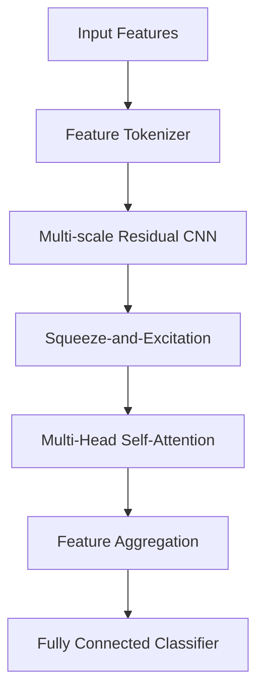

# 6. Mô hình CNN mở rộng

## 6.1. Mục tiêu nghiên cứu

Xây dựng mô hình phát hiện tấn công mạng dựa trên CNN,
kết hợp Squeeze-and-Excitation và Multi-Head Self-Attention.

## 6.2. Kiến trúc mô hình

CNN sử dụng các kernel kích thước 1, 3 và 5.
SE tái hiệu chỉnh các kênh đặc trưng.
MHSA học quan hệ giữa các feature token.
Attention không được diễn giải là attention theo thời gian
vì dữ liệu CSV không có chuỗi timestamp.

## 6.3. Cấu hình Ablation

| Mô hình | Residual CNN | SE | MHSA |
|---|---|---|---|
| CNN | Có | Không | Không |
| CNN + SE | Có | Có | Không |
| CNN + MHSA | Có | Không | Có |
| CNN + SE + MHSA | Có | Có | Có |

Các mô hình giữ nguyên backbone để đánh giá
đóng góp riêng của SE và MHSA.

**Chế độ thực nghiệm: smoke.**

> Đây là kết quả Smoke Test, không phải kết quả huấn luyện chính thức.

## CIC-IDS2017: Cấu hình huấn luyện

- Thiết bị: cpu
- Số đặc trưng: 60
- Số lớp: 15
- Số epoch tối đa: 2
- Batch size: 256
- Width: 16
- Learning rate: 0.001
- Random seed: 42

## CTU-13: Cấu hình huấn luyện

- Thiết bị: cpu
- Số đặc trưng: 57
- Số lớp: 2
- Số epoch tối đa: 2
- Batch size: 256
- Width: 16
- Learning rate: 0.001
- Random seed: 42