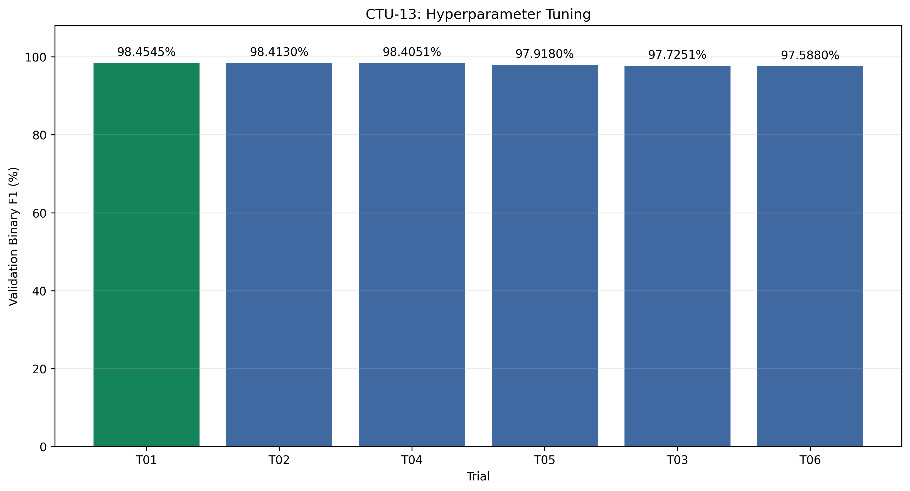
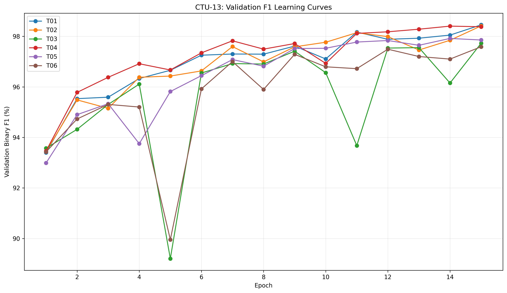

# Hyperparameter Tuning — CTU-13

## 1. Mục tiêu

Lựa chọn siêu tham số cho CNN + SE + MHSA theo Validation Binary F1 (lớp 1).

## 2. Phương pháp

- Train: 57.903 mẫu; validation: 12.408 mẫu.
- Không đọc tập test trong tuning.
- GPU: Tesla T4
- AMP FP16; seed 42; batch size 512; tối đa 15 epoch; patience 5.
- Commit dữ liệu/mã nguồn: dfb84460072a0bcaeed01d9eec0e1ac0dd371531

## 3. Kết quả

| Trial | Width | LR | Dropout | Weight | Accuracy | Precision | Recall | Validation F1 | Best epoch |
|---|---:|---:|---:|---|---:|---:|---:|---:|---:|
| T01 | 32 | 0.001 | 0.1 | none | 98.8556% | 98.8418% | 98.0703% | 98.4545% | 15 |
| T02 | 32 | 0.001 | 0.1 | sqrt | 98.8233% | 98.6704% | 98.1570% | 98.4130% | 15 |
| T04 | 64 | 0.001 | 0.1 | sqrt | 98.8153% | 98.4799% | 98.3304% | 98.4051% | 14 |
| T05 | 32 | 0.0005 | 0.1 | sqrt | 98.4365% | 96.9401% | 98.9159% | 97.9180% | 14 |
| T03 | 32 | 0.001 | 0.1 | balanced | 98.2834% | 96.2955% | 99.1977% | 97.7251% | 15 |
| T06 | 32 | 0.001 | 0.2 | sqrt | 98.2108% | 97.8005% | 97.3764% | 97.5880% | 15 |

## 4. Biểu đồ

## 5. Cấu hình được chọn

- Trial: T01
- Width: 32
- LR: 0.001
- Dropout: 0.1
- Class weight: none
- Validation F1: 98.4545%

## 6. Giới hạn

Sáu cấu hình với một seed trên tập chia nội bộ ngẫu nhiên; không phải đánh giá độc lập theo thời gian hoặc kịch bản. Nhãn CTU là nhãn của bộ CSV đang sử dụng. Chưa đánh giá test chính thức và chưa chứng minh vượt baseline.
