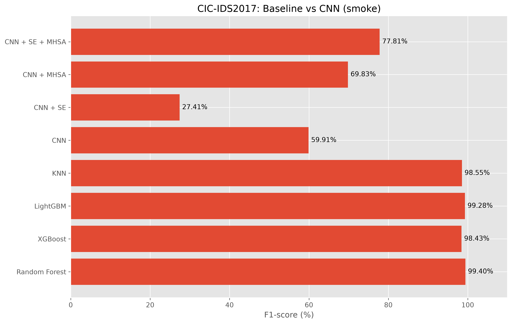
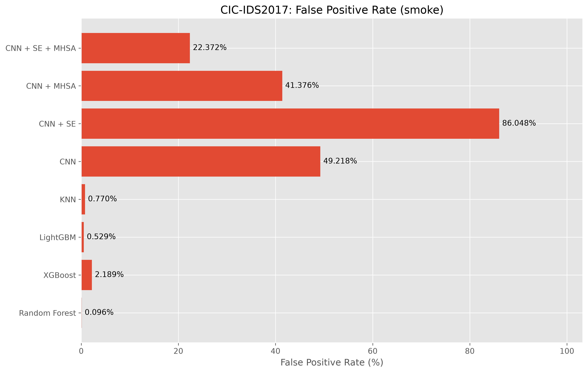
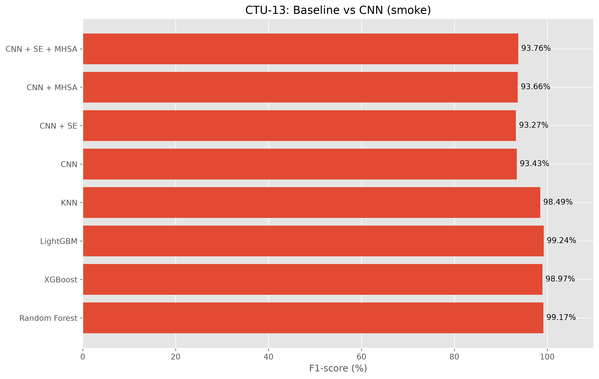
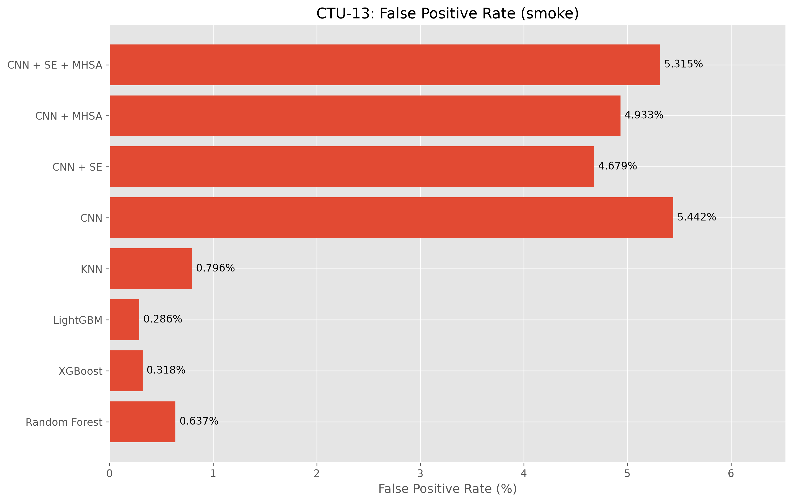

# 8. So sánh Baseline và mô hình đề xuất

Các mô hình được đối chiếu theo cùng profile,
schema đặc trưng và thông tin chia tập dữ liệu.

> Đây là kết quả Smoke Test, không phải kết quả huấn luyện chính thức.

## CIC-IDS2017

| Mô hình | Accuracy | Precision | Recall | F1-score |
|---|---:|---:|---:|---:|
| Random Forest | 99.4803% | 99.4014% | 99.4803% | 99.4003% |
| XGBoost | 97.9212% | 99.0543% | 97.9212% | 98.4336% |
| LightGBM | 99.2604% | 99.3460% | 99.2604% | 99.2840% |
| KNN | 98.6208% | 98.5410% | 98.6208% | 98.5460% |
| CNN | 52.3486% | 83.9756% | 52.3486% | 59.9101% |
| CNN + SE | 23.3260% | 79.1121% | 23.3260% | 27.4130% |
| CNN + MHSA | 63.8217% | 88.5404% | 63.8217% | 69.8308% |
| CNN + SE + MHSA | 74.3754% | 85.1470% | 74.3754% | 77.8075% |

### Phân tích kết quả

Baseline có Test F1 cao nhất: Random Forest, 99.4003%.

Chênh lệch F1 của mô hình đề xuất so với baseline cao nhất: -21.5928 điểm phần trăm.

FPR của mô hình đề xuất: 22.3719%.

Mô hình đề xuất chưa vượt baseline.

## CTU-13

| Mô hình | Accuracy | Precision | Recall | F1-score |
|---|---:|---:|---:|---:|
| Random Forest | 99.3800% | 98.9288% | 99.4080% | 99.1678% |
| XGBoost | 99.2400% | 99.4565% | 98.4930% | 98.9724% |
| LightGBM | 99.4400% | 99.5130% | 98.9774% | 99.2445% |
| KNN | 98.8800% | 98.6501% | 98.3315% | 98.4906% |
| CNN | 95.0000% | 91.2308% | 95.7481% | 93.4349% |
| CNN + SE | 94.9400% | 92.2591% | 94.2949% | 93.2659% |
| CNN + MHSA | 95.2000% | 91.9606% | 95.4252% | 93.6609% |
| CNN + SE + MHSA | 95.2400% | 91.4534% | 96.1787% | 93.7566% |

### Phân tích kết quả

Baseline có Test F1 cao nhất: LightGBM, 99.2445%.

Chênh lệch F1 của mô hình đề xuất so với baseline cao nhất: -5.4879 điểm phần trăm.

FPR của mô hình đề xuất: 5.3151%.

Mô hình đề xuất chưa vượt baseline.

## Giới hạn thực nghiệm

- Không sử dụng tập test để tối ưu siêu tham số.
- Cần kiểm tra chỉ số từng lớp, đặc biệt lớp hiếm.
- Smoke Test không chứng minh hiệu quả cuối cùng.
- Thời gian đánh giá trung bình theo batch không phải
  độ trễ phát hiện tấn công trong hệ thống realtime.
- Cần thực nghiệm chính thức trước khi kết luận ưu thế CNN.