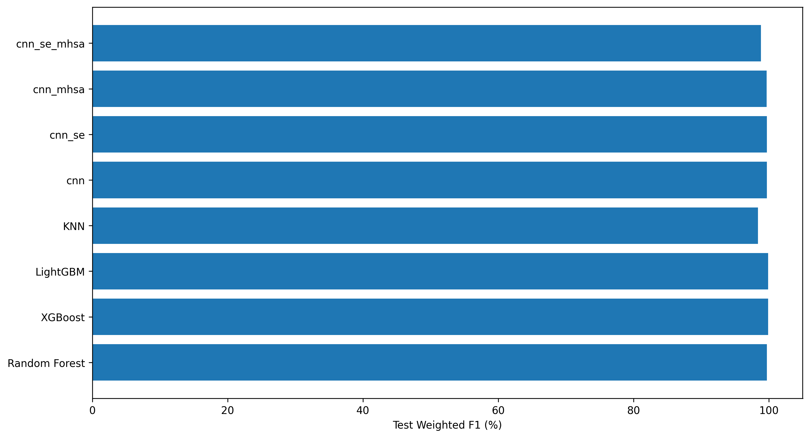
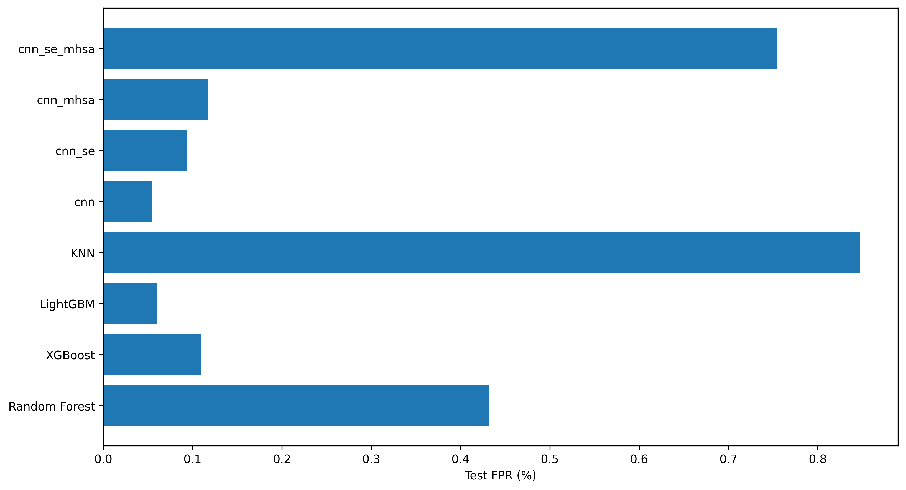
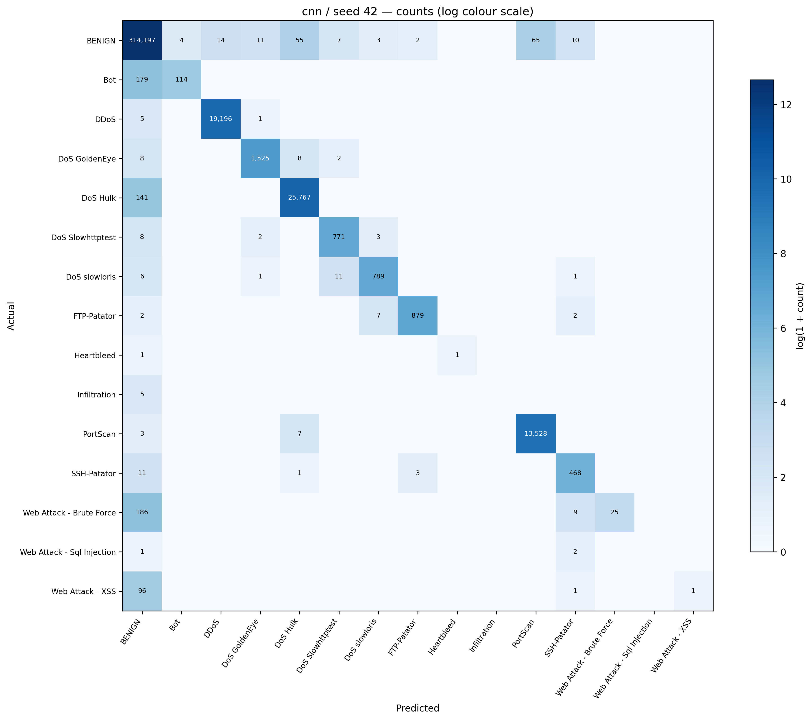
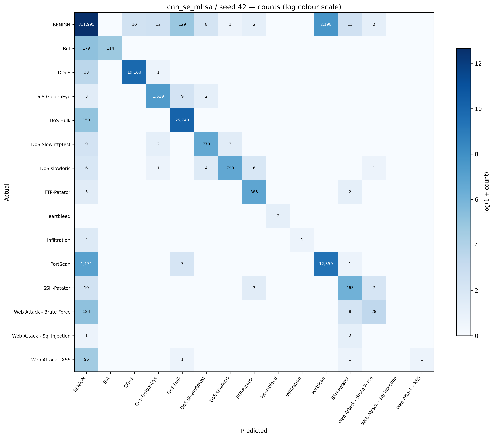
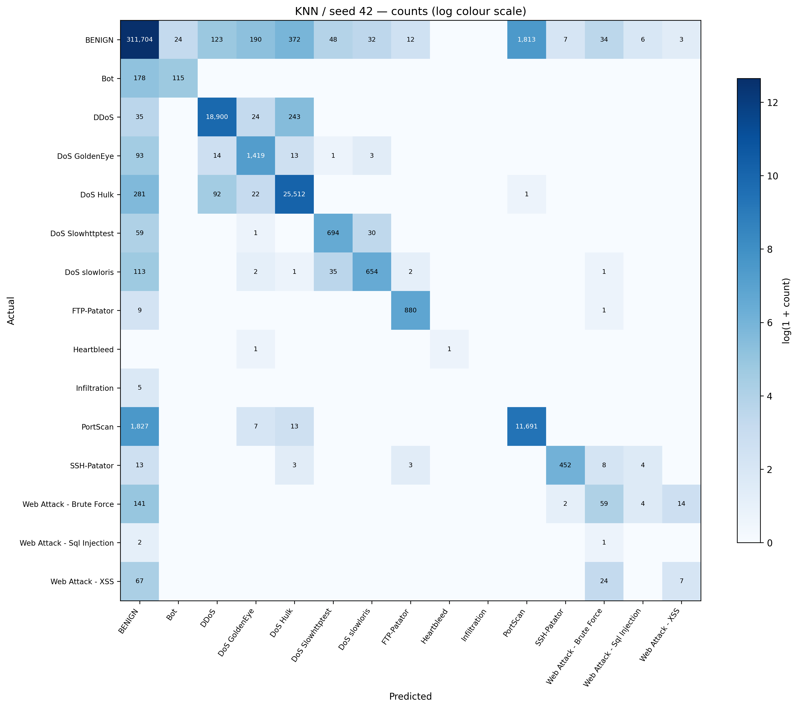
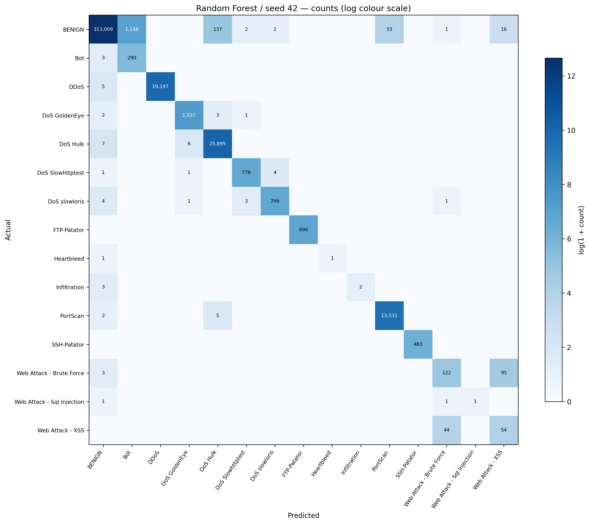
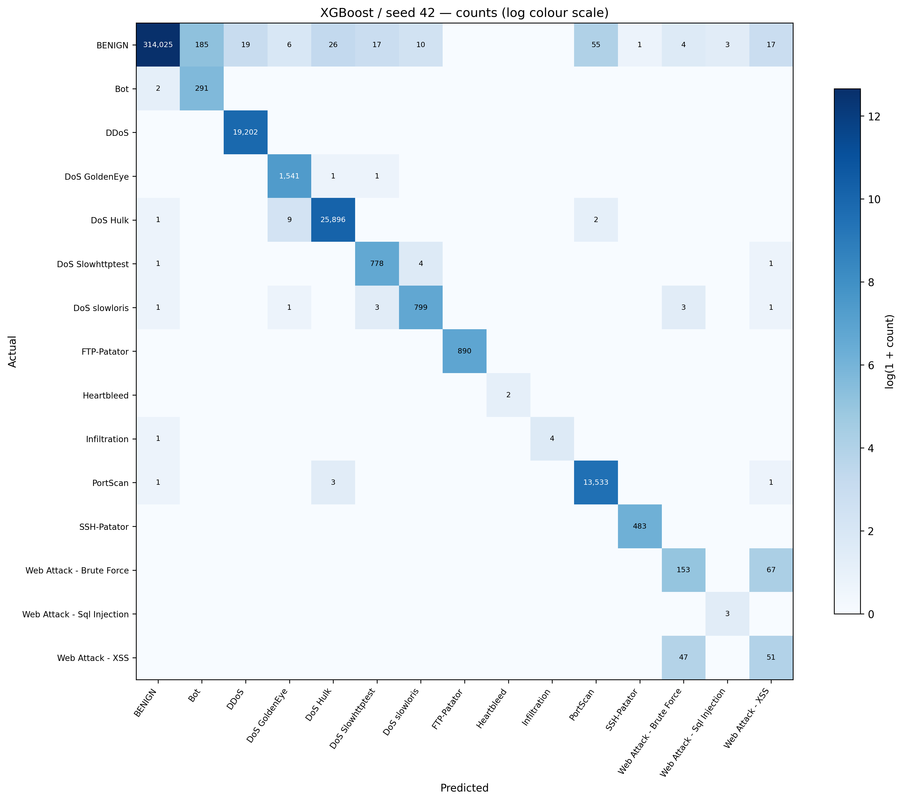

# CIC-IDS2017 — Full Training và Ablation

Hoàn thành toàn bộ: False. Số lượt CNN hiện có: 4.
Thiết kế: T01 cố định; CNN seed 42/43/44, baseline seed 42. Train 1.764.676, validation/test mỗi tập 378.145. KNN giảm mẫu train; xem all_runs.csv.

| Model | Accuracy | Precision | Recall | Weighted F1 | F1 SD | FPR |
|---|---:|---:|---:|---:|---:|---:|
| Random Forest | 99.5885% | 99.8386% | 99.5885% | 99.6912% | — | 0.4323% |
| XGBoost | 99.8694% | 99.8946% | 99.8694% | 99.8779% | — | 0.1091% |
| LightGBM | 99.9000% | 99.9082% | 99.9000% | 99.9029% | — | 0.0601% |
| KNN | 98.3982% | 98.3689% | 98.3982% | 98.3729% | — | 0.8474% |
| cnn | 99.7662% | 99.7630% | 99.7662% | 99.7218% | — | 0.0544% |
| cnn_se | 99.7482% | 99.7477% | 99.7482% | 99.7045% | — | 0.0932% |
| cnn_mhsa | 99.7189% | 99.6889% | 99.7189% | 99.6727% | — | 0.1171% |
| cnn_se_mhsa | 98.8653% | 98.8917% | 98.8653% | 98.8384% | — | 0.7548% |

SD tính theo điểm phần trăm; baseline một seed không có SD.

## Gaussian độc lập

Validation binary F1: 15.6464%; Test binary F1: 15.6883%; Test FPR: 0.7676%.

## Biểu đồ

Ma trận 15 lớp seed 42: hiển thị số đếm khác 0, màu theo log(1 + count). Không thay đổi số liệu gốc.

## Giới hạn

Chia tập ngẫu nhiên nội bộ, lớp hiếm cần phân tích riêng. Không chọn cấu hình hoặc seed theo test. KNN dùng tập train rút gọn. So sánh baseline một seed với CNN ba seed chỉ mang tính mô tả; chưa khẳng định ý nghĩa thống kê hay hiệu năng realtime.
