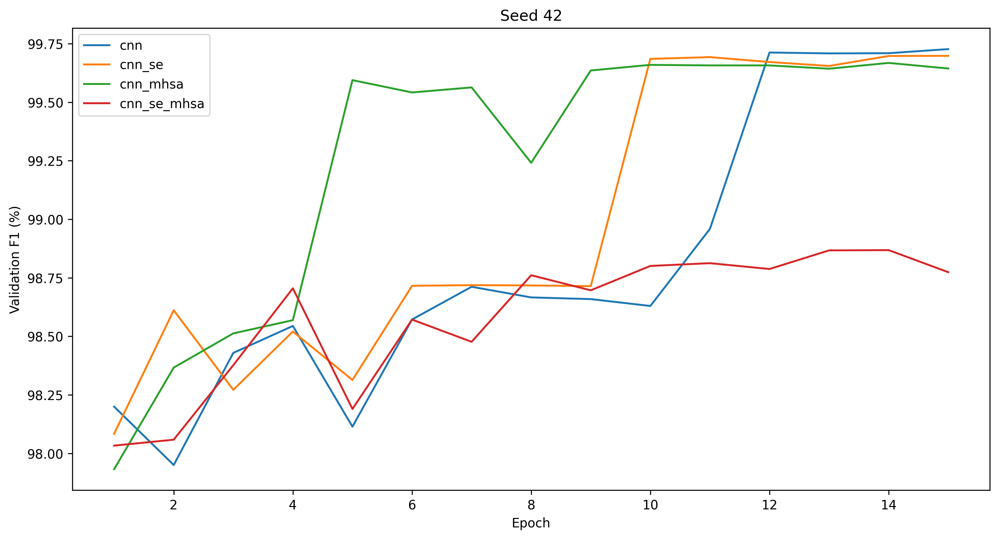
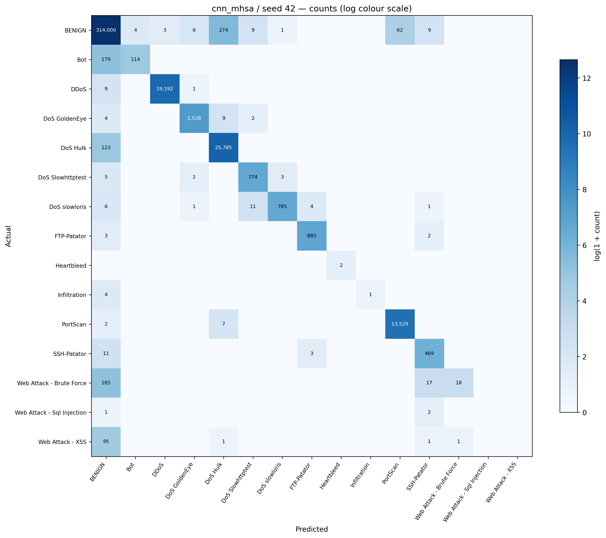
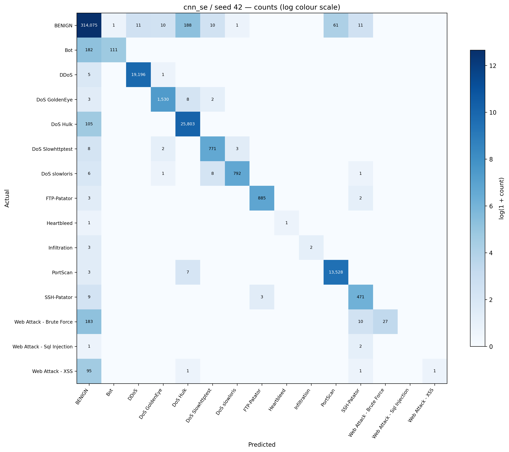
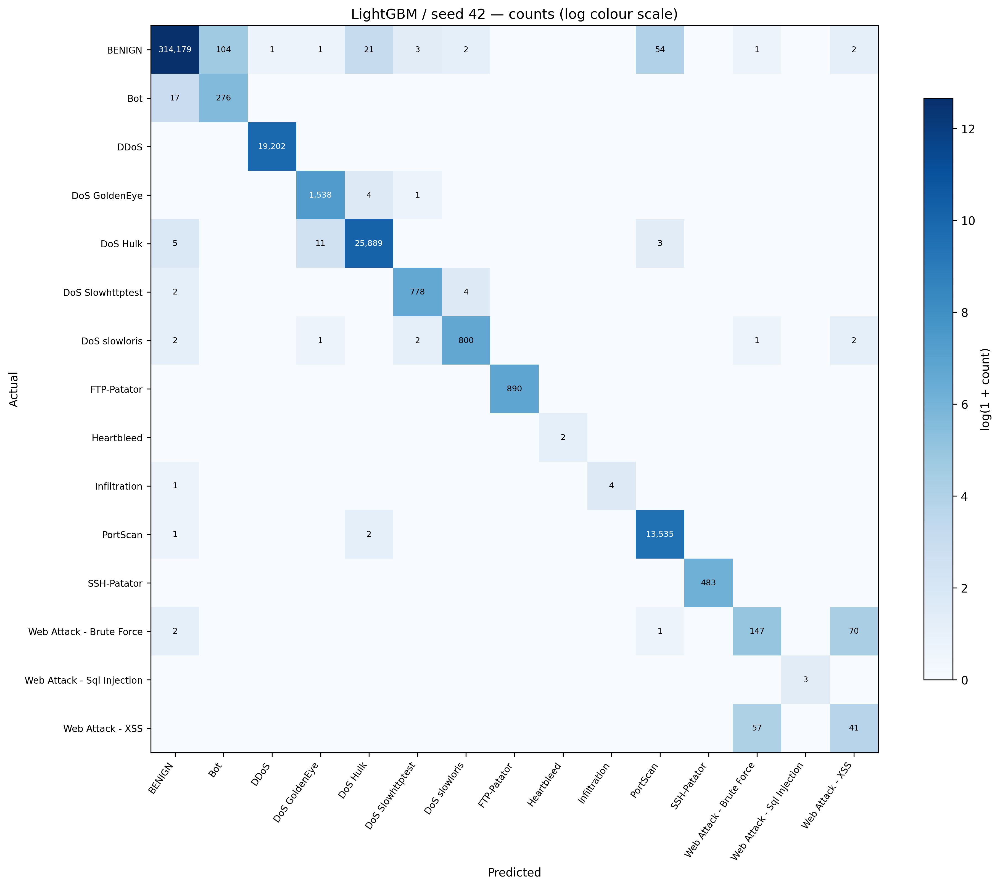

# CIC-IDS2017 — Full Training và Ablation

Hoàn thành toàn bộ: False. Số lượt CNN hiện có: 8.
Thiết kế: T01 cố định; CNN seed 42/43, baseline seed 42. Train 1.764.676, validation/test mỗi tập 378.145. KNN giảm mẫu train; xem all_runs.csv.

| Model | Accuracy | Precision | Recall | Weighted F1 | F1 SD | FPR |
|---|---:|---:|---:|---:|---:|---:|
| Random Forest | 99.5885% | 99.8386% | 99.5885% | 99.6912% | — | 0.4323% |
| XGBoost | 99.8694% | 99.8946% | 99.8694% | 99.8779% | — | 0.1091% |
| LightGBM | 99.9000% | 99.9082% | 99.9000% | 99.9029% | — | 0.0601% |
| KNN | 98.3982% | 98.3689% | 98.3982% | 98.3729% | — | 0.8474% |
| cnn | 99.3042% | 99.3298% | 99.3042% | 99.2691% | 0.6403 | 0.4536% |
| cnn_se | 99.3038% | 99.2926% | 99.3038% | 99.2519% | 0.6401 | 0.2906% |
| cnn_mhsa | 99.3026% | 99.2801% | 99.3026% | 99.2559% | 0.5893 | 0.3539% |
| cnn_se_mhsa | 98.8130% | 98.8287% | 98.8130% | 98.7840% | 0.0769 | 0.7792% |

SD tính theo điểm phần trăm; baseline một seed không có SD.

## Gaussian độc lập

Validation binary F1: 15.6464%; Test binary F1: 15.6883%; Test FPR: 0.7676%.

## Biểu đồ

## Giới hạn

Chia tập ngẫu nhiên nội bộ, lớp hiếm cần phân tích riêng. Không chọn cấu hình hoặc seed theo test. KNN dùng tập train rút gọn. So sánh baseline một seed với CNN hai seed chỉ mang tính mô tả; chưa khẳng định ý nghĩa thống kê hay hiệu năng realtime.

## L?a ch?n m? h?nh ch?nh th?c

M? h?nh ch?nh c?a ?? ?n l? Multi-Scale Residual CNN
k?t h?p Multi-Head Self-Attention (CNN + MHSA).

Checkpoint tri?n khai: cnn_mhsa.pt, seed 42.

K?t qu? trung b?nh hai seed:
- Accuracy: 99.3026%.
- Weighted F1: 99.2559%.
- FPR: 0.3539%.
- F1 sample SD: 0.5893 ?i?m ph?n tr?m.

C?u h?nh CIC Final:
- Width: 32.
- Learning rate: 0.001.
- Dropout: 0.1.
- Batch size: 512.
- Epochs t?i ?a: 15.
- Patience: 5.
- Class weighting: none.

CNN + MHSA ???c ch?n sau Ablation Study.
M? h?nh ch?a v??t c?c ML baseline m?nh v? Weighted F1.
K?t qu? ch? ph?n ?nh ??nh gi? offline tr?n t?p test n?i b?.

Chi ti?t: [MODEL_SELECTION](../MODEL_SELECTION.md).
