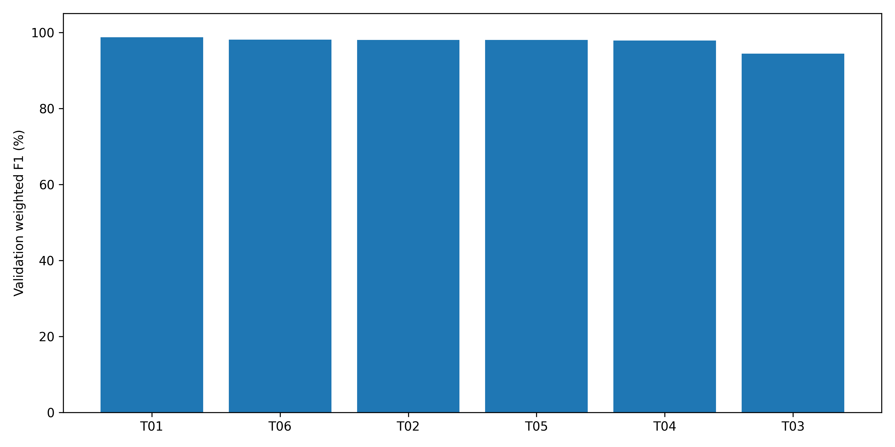
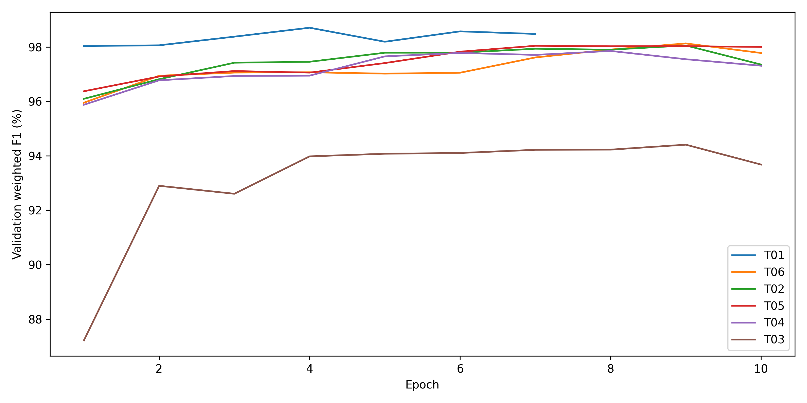

# CIC-IDS2017 — Hyperparameter Tuning

Hoàn thành 6/6 trial. Train 1.764.676; validation 378.145. F1 weighted; không đánh giá test trong tuning.

| Trial | Width | LR | Dropout | Weight | Validation F1 |
|---|---:|---:|---:|---|---:|
| T01 | 32 | 0.001 | 0.1 | none | 98.7051% |
| T06 | 32 | 0.001 | 0.2 | sqrt | 98.1281% |
| T02 | 32 | 0.001 | 0.1 | sqrt | 98.0537% |
| T05 | 32 | 0.0005 | 0.1 | sqrt | 98.0414% |
| T04 | 64 | 0.001 | 0.1 | sqrt | 97.8517% |
| T03 | 32 | 0.001 | 0.1 | balanced | 94.4078% |

Cấu hình được chọn: T01

Giới hạn: một seed, ngân sách 10 epoch; chia tập ngẫu nhiên nội bộ, lớp hiếm cần xem báo cáo từng lớp.
