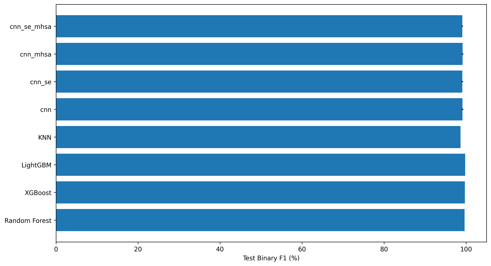
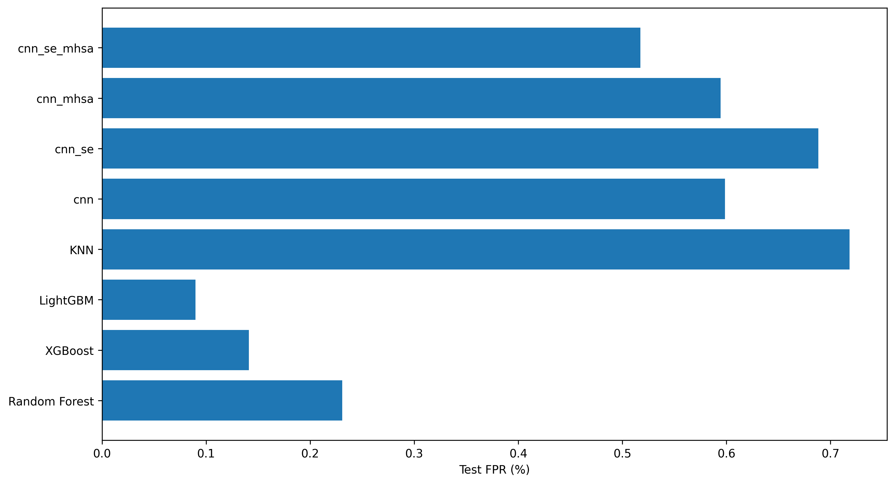
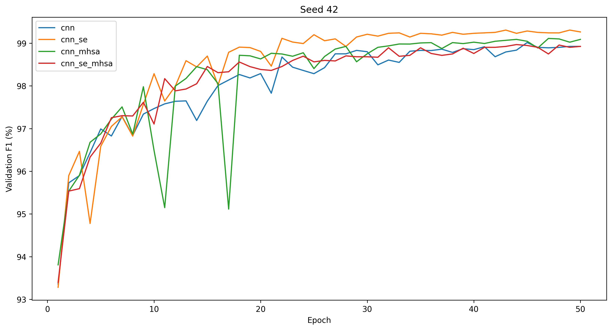
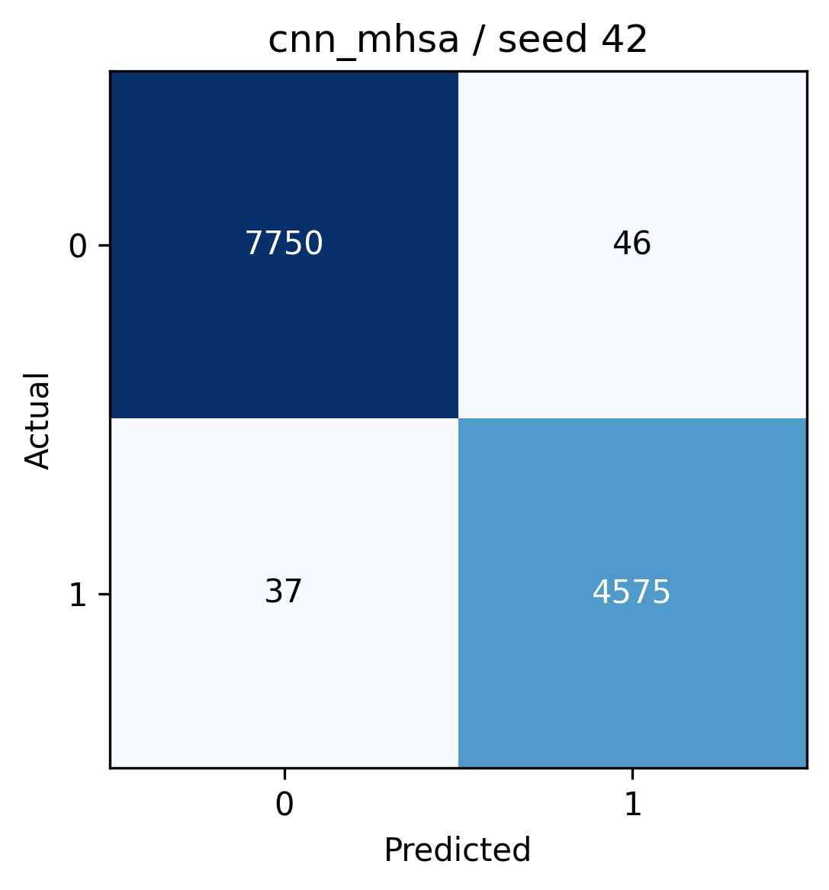
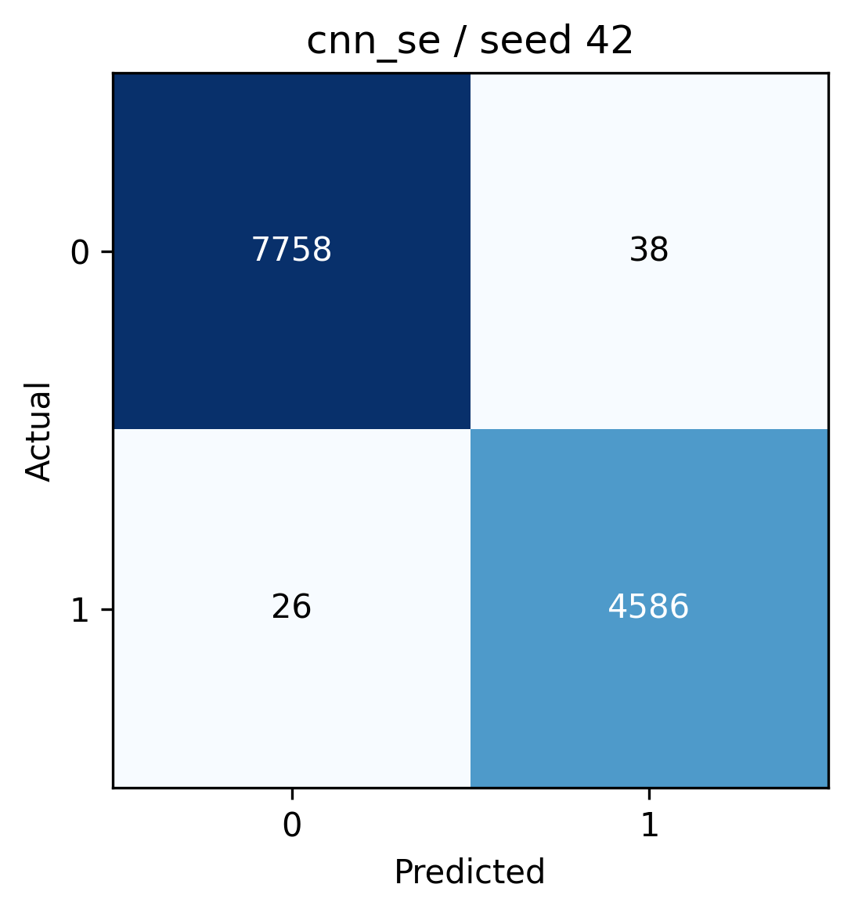
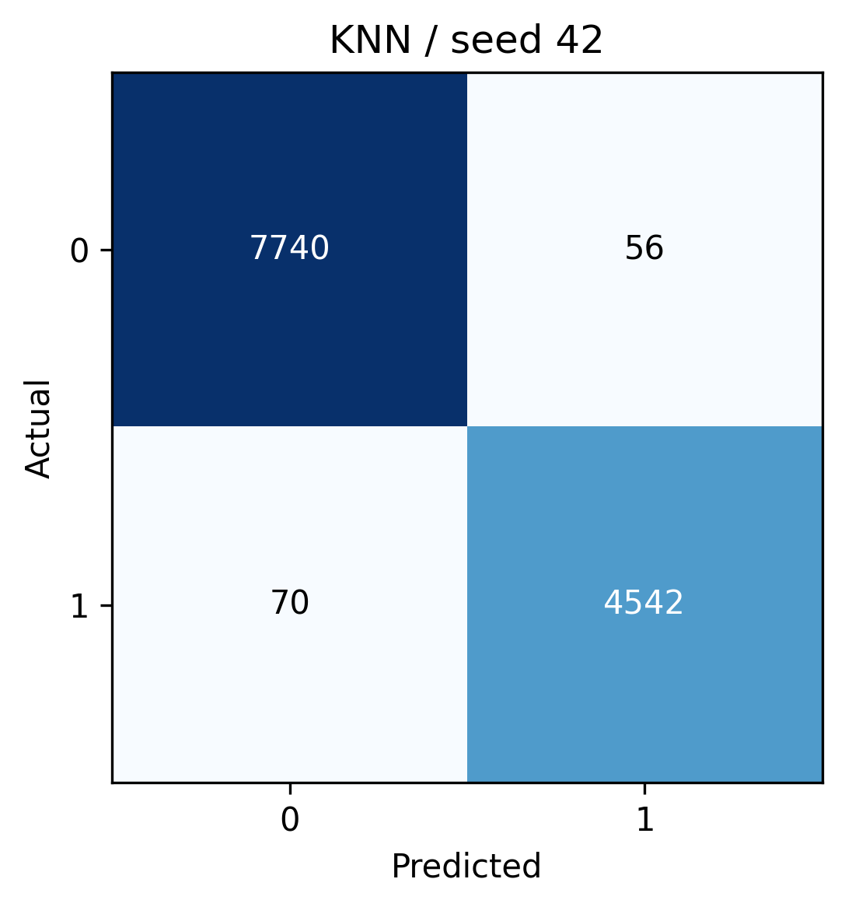
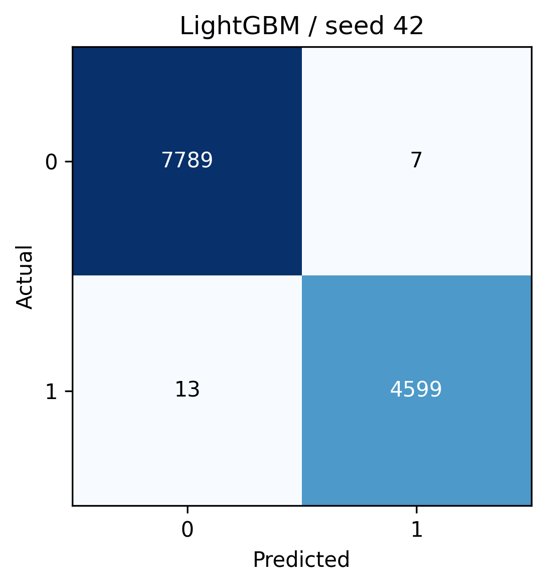
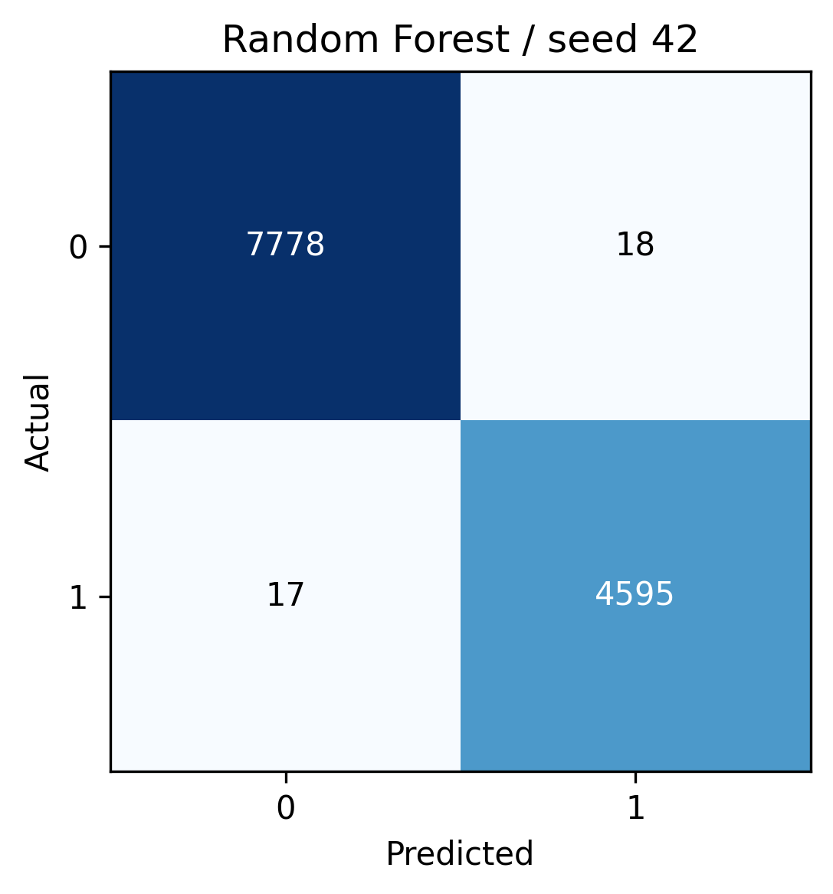
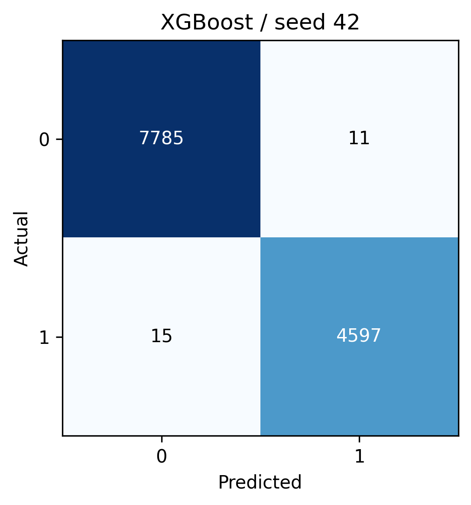

# CTU-13 — Full Training và Ablation

Thiết kế: T01 cố định; CNN seed 42/43/44, baseline seed 42. Train 57.903, validation/test mỗi tập 12.408. KNN giảm mẫu train; xem all_runs.csv.

| Model | Accuracy | Precision | Recall | Binary F1 | F1 SD | FPR |
|---|---:|---:|---:|---:|---:|---:|
| Random Forest | 99.7179% | 99.6098% | 99.6314% | 99.6206% | — | 0.2309% |
| XGBoost | 99.7905% | 99.7613% | 99.6748% | 99.7180% | — | 0.1411% |
| LightGBM | 99.8388% | 99.8480% | 99.7181% | 99.7830% | — | 0.0898% |
| KNN | 98.9845% | 98.7821% | 98.4822% | 98.6319% | — | 0.7183% |
| cnn | 99.3499% | 98.9908% | 99.2628% | 99.1266% | 0.2047 | 0.5986% |
| cnn_se | 99.3123% | 98.8424% | 99.3134% | 99.0772% | 0.2035 | 0.6884% |
| cnn_mhsa | 99.3741% | 98.9987% | 99.3206% | 99.1594% | 0.1906 | 0.5943% |
| cnn_se_mhsa | 99.3284% | 99.1255% | 99.0676% | 99.0960% | 0.1500 | 0.5174% |

SD tính theo điểm phần trăm; baseline một seed không có SD.

## Gaussian độc lập

Validation F1: 10.6991%; Test F1: 11.1494%; Test FPR: 0.5900%.

## Biểu đồ

## Giới hạn

Chia tập ngẫu nhiên nội bộ, nhãn CTU theo proxy. Không chọn cấu hình hoặc seed theo test. KNN dùng tập train rút gọn. So sánh baseline một seed với CNN ba seed chỉ mang tính mô tả; chưa khẳng định ý nghĩa thống kê hay hiệu năng realtime.
